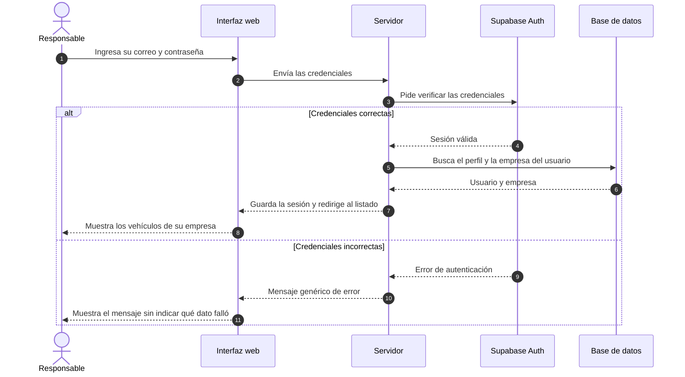
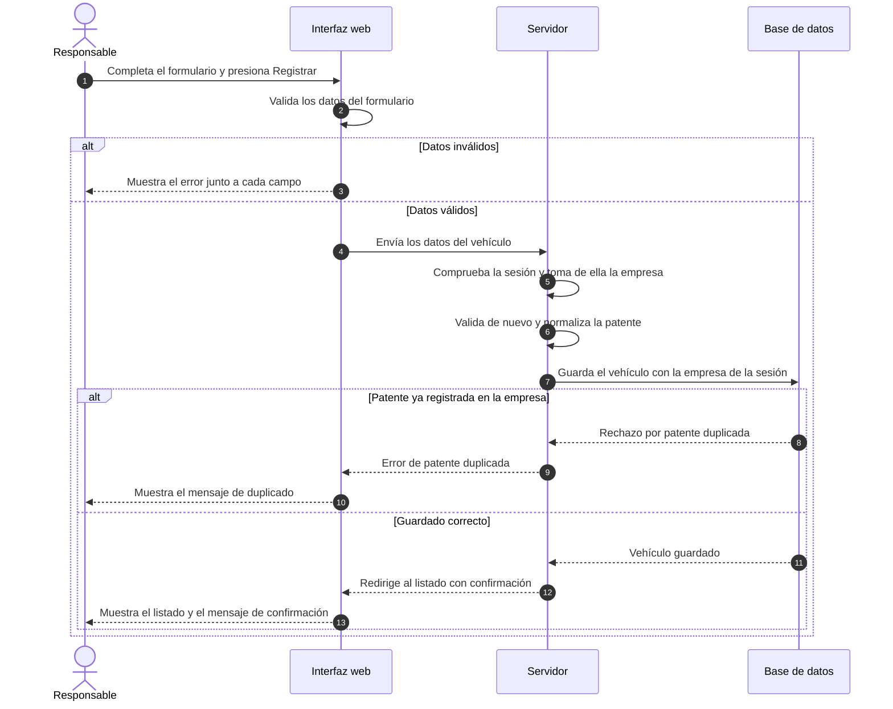
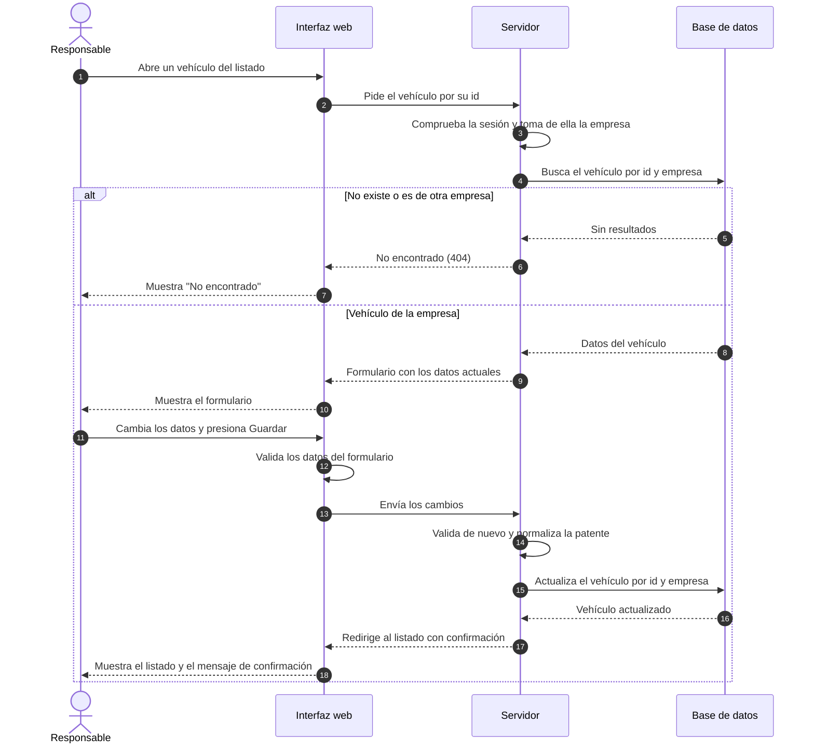
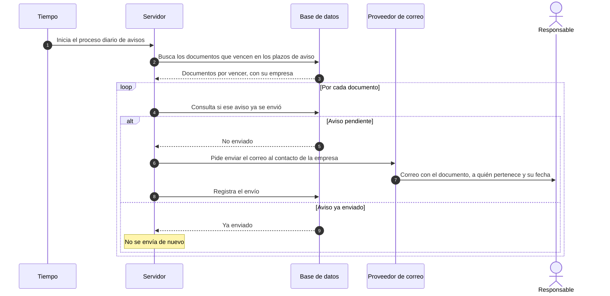
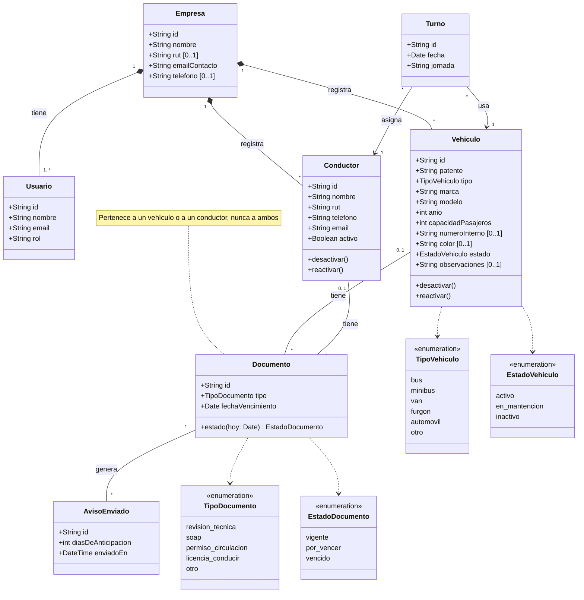
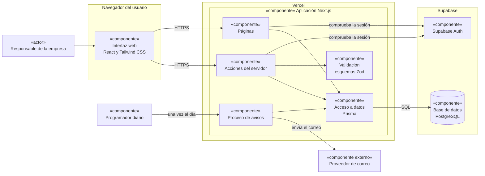

# JOA-06 · Diagramas UML de MicroLogist

| | |
|---|---|
| **Tarea** | [JOA-06] Elaborar diagramas UML |
| **Responsable** | Joaquín Orellana (Product Owner) |
| **Revisión** | José Vargas (modelo de datos) y Simón Jofré (acceso) |
| **Estado** | Propuesta para revisión del equipo |
| **Fecha** | 12-10-2026 |
| **Actualización** | 16-10-2026: se agregan los diagramas de clases y de componentes |

Este documento contiene los diagramas UML del MVP: casos de uso, secuencia de los flujos principales, clases y componentes. Se basa en las reglas de [JOA-01](JOA-01_Reglas_Modulo_Vehiculos.md), en la [Product Vision](JOA-04_Product_Vision.md) y en el Product Backlog (JOA-08).

Los diagramas están escritos en [Mermaid](https://mermaid.js.org/), dentro de este mismo archivo. GitHub los dibuja al abrir el documento, y su código queda versionado junto con el resto del repositorio: para cambiar un diagrama se edita el texto y se revisa en un pull request, igual que cualquier otro cambio.

---

## 1. Diagrama de casos de uso

Muestra quién usa MicroLogist y qué puede hacer en el MVP.

### 1.1 Actores

| Actor | Quién es | Qué hace |
|---|---|---|
| **Responsable de la empresa** | El dueño o encargado de una empresa de transporte. Es el único usuario del MVP, con rol `admin`. | Inicia sesión y gestiona los vehículos, conductores, documentos y turnos de su empresa. También recibe los correos de aviso. |
| **Tiempo** | No es una persona: representa que el sistema actúa solo, una vez al día. | Inicia el envío de avisos de vencimiento. |
| **Proveedor de correo** | Servicio externo que entrega los correos. Cuál se usará está **[POR CONFIRMAR]** (JOA-01, sección 5). | Recibe del sistema cada aviso y lo entrega al responsable. |

El **conductor no es un actor**: en el MVP es un registro dentro del sistema y no inicia sesión (JOA-01, sección 2.1).

### 1.2 Casos de uso

| ID | Caso de uso | Actor | Ítem del backlog | Etapa |
|---|---|---|---|---|
| CU-01 | Iniciar sesión | Responsable | PB-01 | Primera entrega |
| CU-02 | Cerrar sesión | Responsable | PB-02 | Primera entrega |
| CU-03 | Registrar vehículo | Responsable | PB-04 | Primera entrega |
| CU-04 | Consultar y buscar vehículos | Responsable | PB-05 | Primera entrega |
| CU-05 | Editar vehículo | Responsable | PB-06 | Primera entrega |
| CU-06 | Desactivar o reactivar vehículo | Responsable | PB-07 | Primera entrega |
| CU-07 | Registrar conductor | Responsable | PB-08 | MVP completo |
| CU-08 | Consultar y editar conductores | Responsable | PB-09 | MVP completo |
| CU-09 | Desactivar o reactivar conductor | Responsable | PB-10 | MVP completo |
| CU-10 | Registrar documento con vencimiento | Responsable | PB-11 | MVP completo |
| CU-11 | Consultar documentos y su estado | Responsable | PB-12 | MVP completo |
| CU-12 | Renovar o corregir documento | Responsable | PB-13 | MVP completo |
| CU-13 | Asignar turno | Responsable | PB-17 | MVP completo |
| CU-14 | Consultar turnos por fecha | Responsable | PB-18 | MVP completo |
| CU-15 | Editar o anular turno | Responsable | PB-19 | MVP completo |
| CU-16 | Enviar avisos de vencimiento | Tiempo y proveedor de correo | PB-15 y PB-16 | MVP completo |

### 1.3 Reglas que aplican a todos los casos de uso

- Todos los casos de uso del responsable, salvo CU-01, necesitan una sesión iniciada. Sin sesión, el sistema redirige al inicio de sesión.
- El responsable solo ve y modifica los datos de su empresa (PB-03). No es un caso de uso aparte: es una regla que cumplen todos.

### 1.4 Lo que no aparece en el diagrama

- **Ingresos:** es un módulo opcional y no forma parte del MVP.
- **Datos de contacto de la empresa (PB-14) y resumen de la flota (PB-20):** están en el backlog, pero todavía no se confirma que entren en el MVP. Si se confirman, se agregan al diagrama.
- **Creación de cuentas:** en la primera entrega las cuentas de prueba las crea el equipo, no un usuario desde el sistema (JOA-01, sección 2.3).

---

## 2. Diagramas de secuencia

Muestran, paso a paso, cómo se comunican las partes del sistema en cada flujo. Los participantes son los mismos en todos:

| Participante | Qué es |
|---|---|
| **Interfaz web** | Las pantallas que el responsable ve en su navegador. |
| **Servidor** | La lógica de la aplicación (Next.js), donde se comprueba la sesión y se validan los datos. |
| **Supabase Auth** | El servicio que comprueba las credenciales y maneja las sesiones. |
| **Base de datos** | PostgreSQL, a la que el servidor accede con Prisma. |

### 2.1 Inicio de sesión (CU-01)

- El mensaje de error es el mismo si el correo no existe o si la contraseña es incorrecta (JOA-01, criterio 7.2).
- La contraseña nunca se guarda en nuestras tablas: la maneja Supabase Auth.
- El detalle de cómo se guarda la sesión se define en SIM-02 **[POR CONFIRMAR]**.

### 2.2 Registro de vehículo (CU-03)

- Los datos se validan dos veces con las mismas reglas: en el formulario, para ayudar al usuario, y en el servidor, que es la validación que protege los datos (JOA-01, sección 4).
- Si al servidor le llegan datos inválidos, devuelve los errores por campo y no guarda nada.
- La empresa nunca viene del formulario: el servidor la toma de la sesión (JOA-01, sección 2.4).
- La patente duplicada se detecta con la restricción única de empresa y patente en la base de datos.

### 2.3 Edición de vehículo (CU-05)

- Un vehículo de otra empresa responde "no encontrado" (404) y no 403, para no revelar que existe (JOA-01, sección 2.4).
- Los errores de validación y de patente duplicada se manejan igual que en el registro (sección 2.2).
- Desactivar o reactivar (CU-06) sigue los mismos pasos, cambiando solo el estado del vehículo.

### 2.4 Aviso de vencimiento por correo (CU-16)

Este flujo todavía tiene decisiones pendientes, todas de la sección 5 de JOA-01:

- Los plazos de aviso: 30, 7 y 1 días antes, y el día del vencimiento **[POR CONFIRMAR]**.
- La hora del proceso diario: en la mañana, hora de Chile **[POR CONFIRMAR]**.
- El destinatario: el correo de contacto de la empresa **[POR CONFIRMAR]**.
- El registro de cada envío para no repetir avisos **[POR CONFIRMAR]**.
- Que los documentos de vehículos inactivos no generen avisos **[POR CONFIRMAR]**.
- Qué pasa si el envío falla **[POR CONFIRMAR]**.

El único canal es el correo: no hay avisos por WhatsApp, SMS ni notificaciones push.

---

## 3. Diagrama de clases

Muestra las clases del dominio del MVP, sus atributos principales y cómo se relacionan.

- **Empresa, Usuario y Vehículo** siguen los campos acordados en JOA-01 (secciones 2.2 y 3), con los nombres que ya usa el código (por ejemplo, `capacidadPasajeros` en vez de `capacidad_pasajeros`).
- **Conductor, Documento, Turno y AvisoEnviado** todavía no tienen sus reglas definidas, así que sus atributos son una propuesta **[POR CONFIRMAR]**, tomada del Product Backlog.

- **Atributos opcionales:** los marcados con `[0..1]`. Todas las clases tienen además las fechas de creación y de actualización, que se omiten para que el diagrama se lea mejor.
- **Usuario:** en el MVP cada empresa tiene un solo usuario, con rol `admin`. La relación permite agregar más usuarios después sin cambiar el modelo (JOA-01, sección 2.1). Su `id` es el mismo de Supabase Auth y la contraseña no se guarda en esta clase.
- **Nada se elimina:** los vehículos se desactivan en vez de borrarse (JOA-01, sección 3.2). Que los conductores sigan la misma regla está **[POR CONFIRMAR]**.
- **Estado del documento:** no se guarda; se calcula con la fecha de vencimiento cada vez que se consulta. "Por vencer" significa 30 días o menos **[POR CONFIRMAR]**.
- **Jornada del turno:** los valores posibles están **[POR CONFIRMAR]** (propuesta: mañana, tarde y noche).
- **Ingresos:** no aparece porque es un módulo opcional, fuera del MVP.

---

## 4. Diagrama de componentes

Muestra las partes que forman MicroLogist, dónde se ejecuta cada una y cómo se comunican. Corresponde a las tecnologías definidas en el README.

| Componente | Qué hace | Estado al 16-10-2026 |
|---|---|---|
| **Interfaz web** | Las pantallas que usa el responsable, en computador o celular. | Pantallas de vehículos hechas en JOA-02. |
| **Páginas** | Arman cada pantalla en el servidor con los datos de la empresa del usuario. | Listado, registro y detalle de vehículos, hechos en JOA-02. |
| **Acciones del servidor** | Reciben lo que el usuario guarda, comprueban la sesión, validan y llaman al acceso a datos. | Hechas en JOA-02, todavía sin sesión. |
| **Validación** | Las reglas de JOA-01 en esquemas Zod, compartidas por el formulario y el servidor. | Esquema de vehículo hecho en JOA-02. |
| **Acceso a datos** | Las consultas a la base de datos, siempre filtradas por la empresa de la sesión. | Hoy usa datos de ejemplo en memoria; JOS-03 lo conecta con Prisma. |
| **Supabase Auth** | Comprueba las credenciales y maneja las sesiones. | Pendiente en SIM-02. |
| **Base de datos** | Guarda empresas, usuarios, vehículos y el resto del modelo. | En configuración en JOS-02. |
| **Proceso de avisos** | Busca los documentos por vencer y pide enviar los correos. | Pendiente, módulo del MVP completo. |
| **Programador diario** | Inicia el proceso de avisos una vez al día. Cuál se usará está **[POR CONFIRMAR]**. | Pendiente. |
| **Proveedor de correo** | Entrega los correos de aviso. Cuál se usará está **[POR CONFIRMAR]** (JOA-01, sección 5). | Pendiente. |

---

## 5. Coherencia con el modelo de datos

El diagrama de clases (sección 3) es la propuesta de la que debería partir el modelo de datos. Cuando José documente el modelo (JOS-04), hay que revisar que los nombres de clases, atributos y relaciones coincidan con los suyos, y actualizar este documento si cambian.

---

## 6. Checklist de JOA-06

- [x] Diagrama de casos de uso con actores y funcionalidades del MVP (sección 1).
- [x] Diagramas de secuencia de inicio de sesión, registro y edición de vehículo, y aviso de vencimiento por correo (sección 2).
- [x] Diagramas de clases y de componentes (secciones 3 y 4). Se agregaron porque la revisión de evidencias de la profesora considera cuatro tipos de diagrama UML: casos de uso, clases, secuencia y componentes.
- [x] Diagramas versionados en el repositorio como texto Mermaid dentro de este archivo.
- [ ] Revisión de coherencia con el modelo de datos de JOS-04, cuando exista (sección 5).
- [ ] Revisión de José y Simón en el PR.
