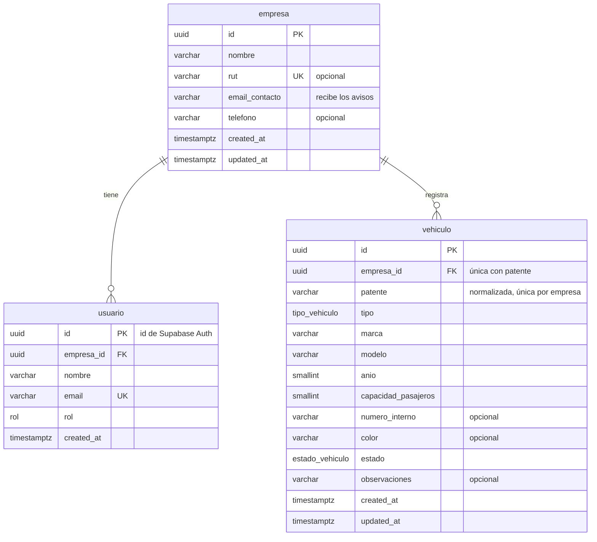
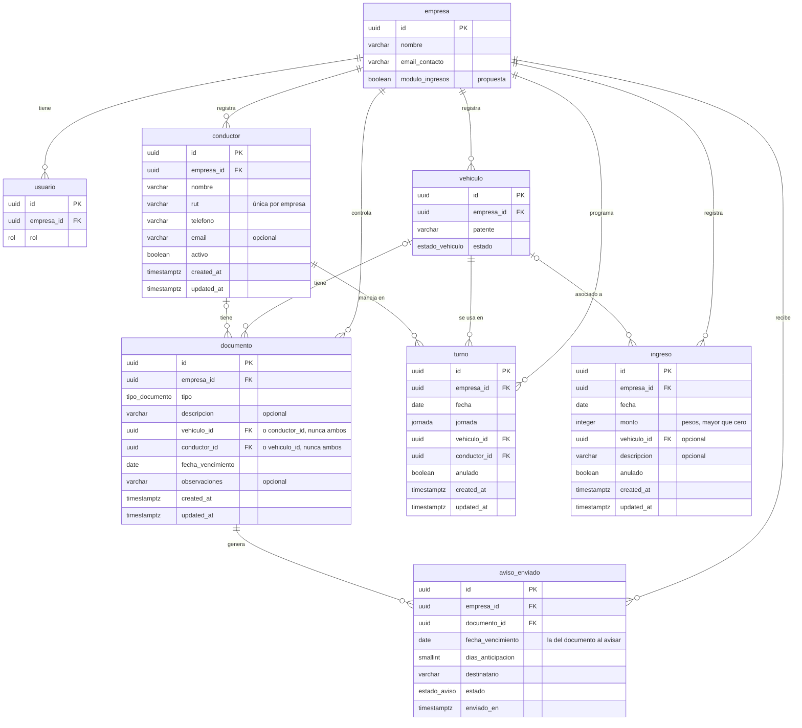

# JOS-04 · Modelo de datos: diagrama entidad-relación y diccionario

| | |
|---|---|
| **Tarea** | [JOS-04] Documentar modelo de datos: DER y diccionario |
| **Responsable** | José Vargas (Developer) |
| **Revisión** | Joaquín Orellana (coherencia con JOA-06 y JOA-08) |
| **Estado** | Propuesta para revisión del equipo |
| **Fecha** | 16-10-2026 (actualizado el 28-10-2026) |

Este documento describe la base de datos de MicroLogist: qué tablas tiene, cómo se relacionan, qué guarda cada columna y cómo se separan los datos entre empresas. Se basa en las reglas de [JOA-01](JOA-01_Reglas_Modulo_Vehiculos.md), en el diagrama de clases de [JOA-06](JOA-06_Diagramas_UML.md) (sección 3) y en el [Product Backlog](JOA-08_Product_Backlog.md).

---

## 1. Cómo leer este documento

El modelo tiene dos partes:

| Parte | Tablas | Estado |
|---|---|---|
| **Implementada** | `empresa`, `usuario`, `vehiculo`, `conductor` | Es exactamente lo que hay en `Base de datos/schema.prisma`. Las tres primeras vienen de la migración inicial (JOS-02); `conductor`, de la migración `conductores` (JOS-09). |
| **Propuesta** | `documento`, `turno`, `aviso_enviado`, `ingreso` | Diseño para los módulos del MVP completo y el módulo opcional de ingresos. Se crea en la tarea de cada módulo, después de confirmar sus reglas. Lo no decidido está marcado **[POR CONFIRMAR]**. |

Convenciones:

- **Nombres:** en la base de datos, tablas y columnas en snake_case y en singular (`capacidad_pasajeros`). En el código, en camelCase (`capacidadPasajeros`), igual que en el diagrama de clases de JOA-06.
- **Identificadores:** todas las tablas usan `id` de tipo `uuid`. Lo genera la aplicación al crear el registro, salvo en `usuario`, donde es el id de Supabase Auth.
- **Fechas:** `created_at` y `updated_at` en todas las tablas que se pueden editar, con zona horaria (`timestamptz`). Las fechas sin hora (vencimientos, turnos, ingresos) son `date` y se interpretan en hora de Chile (`America/Santiago`) **[POR CONFIRMAR]** (JOA-08, PB-12).
- **Nada se elimina:** las relaciones usan `ON DELETE RESTRICT`. Los registros se desactivan o se anulan en vez de borrarse (JOA-01, sección 3.2).

---

## 2. Diagrama entidad-relación

Los diagramas están en [Mermaid](https://mermaid.js.org/), como los de JOA-06: GitHub los dibuja al abrir el archivo. Los largos de texto, los valores permitidos y los demás detalles están en el diccionario (sección 3).

Claves: **PK** = clave primaria, **FK** = clave foránea, **UK** = única.

### 2.1 Modelo implementado (primera entrega)

### 2.2 Modelo completo del MVP (propuesta)

Incluye las tablas implementadas (resumidas) y las propuestas. `ingreso` pertenece al módulo opcional (JOA-08, sección 6).

---

## 3. Diccionario de datos

Columnas: **Obl.** = obligatorio (`NOT NULL`). Las reglas de formato que valida la aplicación con Zod se indican como "(Zod)"; el resto lo asegura la base de datos.

### 3.1 `empresa` · implementada

Cada empresa de transporte. Todos los demás datos cuelgan de ella (JOA-01, sección 2.1).

| Columna | Tipo | Obl. | Restricciones y reglas |
|---|---|---|---|
| `id` | `uuid` | Sí | PK. |
| `nombre` | `varchar(100)` | Sí | Nombre de fantasía o razón social. 2 a 100 caracteres (Zod, cuando exista el formulario de PB-14). |
| `rut` | `varchar(12)` | No | Único si se ingresa. RUT chileno con dígito verificador. Si será obligatorio está **[POR CONFIRMAR]** (JOA-01, 2.2). |
| `email_contacto` | `varchar(254)` | Sí | Correo que recibirá los avisos de vencimiento **[POR CONFIRMAR]** (JOA-01, sección 5). |
| `telefono` | `varchar(20)` | No | Solo contacto; no se usa para avisos. |
| `modulo_ingresos` | `boolean` | Sí | **Propuesta** (PB-21): activa el módulo de ingresos. Por defecto `false` **[POR CONFIRMAR]**. |
| `created_at` | `timestamptz` | Sí | Por defecto, la fecha y hora actual. |
| `updated_at` | `timestamptz` | Sí | Lo actualiza la aplicación en cada cambio. |

### 3.2 `usuario` · implementada

Perfil de quien inicia sesión. La contraseña no está aquí: la maneja Supabase Auth.

| Columna | Tipo | Obl. | Restricciones y reglas |
|---|---|---|---|
| `id` | `uuid` | Sí | PK. Es el mismo id del usuario en Supabase Auth (`auth.users.id`). |
| `empresa_id` | `uuid` | Sí | FK a `empresa`. Un usuario pertenece a una sola empresa. Con índice. |
| `nombre` | `varchar(100)` | Sí | 2 a 100 caracteres. |
| `email` | `varchar(254)` | Sí | Único en todo el sistema. Lo gestiona Supabase Auth. |
| `rol` | `rol` | Sí | Por defecto `admin`, el único rol del MVP. |
| `created_at` | `timestamptz` | Sí | Por defecto, la fecha y hora actual. |

### 3.3 `vehiculo` · implementada

| Columna | Tipo | Obl. | Restricciones y reglas |
|---|---|---|---|
| `id` | `uuid` | Sí | PK. |
| `empresa_id` | `uuid` | Sí | FK a `empresa`. Lo asigna el servidor desde la sesión, nunca el formulario. |
| `patente` | `varchar(6)` | Sí | Se guarda normalizada: mayúsculas, sin espacios, guiones ni puntos. Formato `BBCD12` o `AB1234` (Zod). **Única dentro de la empresa** junto con `empresa_id`, incluidos los inactivos. |
| `tipo` | `tipo_vehiculo` | Sí | Ver sección 3.9. |
| `marca` | `varchar(50)` | Sí | 2 a 50 caracteres (Zod). |
| `modelo` | `varchar(50)` | Sí | 1 a 50 caracteres (Zod). |
| `anio` | `smallint` | Sí | Entre 1980 y el año actual + 1 (Zod). |
| `capacidad_pasajeros` | `smallint` | Sí | 1 a 100 asientos, sin contar al conductor (Zod). |
| `numero_interno` | `varchar(20)` | No | Número de máquina que usa la empresa. |
| `color` | `varchar(30)` | No | |
| `estado` | `estado_vehiculo` | Sí | Por defecto `activo`. Pasar a o desde `inactivo` solo con el botón de desactivar o reactivar. |
| `observaciones` | `varchar(500)` | No | |
| `created_at`, `updated_at` | `timestamptz` | Sí | Como en `empresa`. |

Restricción única: `(empresa_id, patente)`. Para las tablas propuestas se agrega además `UNIQUE (id, empresa_id)`, que permite las claves foráneas compuestas de la sección 4.

### 3.4 `conductor` · implementada en JOS-09 (PB-08 a PB-10)

El conductor es un registro, no una cuenta: no inicia sesión (JOA-01, sección 2.1). Las reglas de los campos están en [JOA-09](JOA-09_Reglas_Modulo_Conductores.md).

| Columna | Tipo | Obl. | Restricciones y reglas |
|---|---|---|---|
| `id` | `uuid` | Sí | PK. |
| `empresa_id` | `uuid` | Sí | FK a `empresa`. |
| `nombre` | `varchar(100)` | Sí | 2 a 100 caracteres, con los espacios normalizados. |
| `rut` | `varchar(10)` | Sí | Normalizado como `12345678-9` (sin puntos, `K` mayúscula), con dígito verificador válido (Zod). **Único dentro de la empresa**, incluidos los inactivos; otra empresa sí puede tenerlo (JOA-09, sección 2). |
| `telefono` | `varchar(12)` | Sí | Normalizado como `+56` seguido de 9 dígitos (JOA-09, sección 3.2). |
| `email` | `varchar(254)` | No | Se guarda en minúsculas (JOS-10). No se usa para avisos: estos van al correo de la empresa ([JOA-13](JOA-13_Reglas_Alertas_Vencimiento.md)). |
| `activo` | `boolean` | Sí | Por defecto `true`. Un conductor inactivo no aparece en el listado por defecto ni se asigna a turnos nuevos (PB-10). |
| `created_at`, `updated_at` | `timestamptz` | Sí | |

Restricciones únicas: `(empresa_id, rut)` y `(id, empresa_id)`.

### 3.5 `documento` · propuesta (PB-11 a PB-13)

Un documento pertenece a un vehículo **o** a un conductor, nunca a ambos (nota del diagrama de clases de JOA-06).

| Columna | Tipo | Obl. | Restricciones y reglas |
|---|---|---|---|
| `id` | `uuid` | Sí | PK. |
| `empresa_id` | `uuid` | Sí | FK a `empresa`. |
| `tipo` | `tipo_documento` | Sí | Ver sección 3.9. |
| `descripcion` | `varchar(100)` | No | Obligatoria cuando `tipo` es `otro` **[POR CONFIRMAR]**. |
| `vehiculo_id` | `uuid` | No | FK compuesta `(vehiculo_id, empresa_id)` a `vehiculo`. |
| `conductor_id` | `uuid` | No | FK compuesta `(conductor_id, empresa_id)` a `conductor`. |
| `fecha_vencimiento` | `date` | Sí | |
| `observaciones` | `varchar(500)` | No | |
| `created_at`, `updated_at` | `timestamptz` | Sí | |

Reglas (restricciones `CHECK` en la migración):

1. Exactamente uno de `vehiculo_id` o `conductor_id` tiene valor.
2. `revision_tecnica`, `soap` y `permiso_circulacion` solo para vehículos; `licencia_conducir` solo para conductores; `otro` para ambos.

Otros puntos:

- **El estado no se guarda:** vigente, por vencer o vencido se calcula con `fecha_vencimiento` y la fecha de hoy. "Por vencer" es 30 días o menos **[POR CONFIRMAR]** (PB-12).
- **Renovar es editar la fecha** (PB-13). Guardar el historial de vencimientos anteriores está **[POR CONFIRMAR]**; si se confirma, se agrega una tabla de historial.
- **Sin archivo adjunto** en el MVP **[POR CONFIRMAR]** (JOA-01, sección 1.4).
- Índice `(empresa_id, fecha_vencimiento)` para el listado general y para el proceso de avisos.

Restricción única adicional: `(id, empresa_id)`.

### 3.6 `turno` · propuesta (PB-17 a PB-19)

| Columna | Tipo | Obl. | Restricciones y reglas |
|---|---|---|---|
| `id` | `uuid` | Sí | PK. |
| `empresa_id` | `uuid` | Sí | FK a `empresa`. |
| `fecha` | `date` | Sí | |
| `jornada` | `jornada` | Sí | Ver sección 3.9. |
| `vehiculo_id` | `uuid` | Sí | FK compuesta a `vehiculo`. Al crear, no puede estar inactivo; si puede estar en mantención está **[POR CONFIRMAR]** (PB-17). |
| `conductor_id` | `uuid` | Sí | FK compuesta a `conductor`. Al crear, debe estar activo. |
| `anulado` | `boolean` | Sí | Por defecto `false`. Anular marca el turno en vez de borrarlo **[POR CONFIRMAR]** (PB-19). |
| `created_at`, `updated_at` | `timestamptz` | Sí | |

- Un vehículo o un conductor no puede estar en dos turnos de la misma fecha y jornada **[POR CONFIRMAR]** (PB-17). Se implementa con dos índices únicos parciales, `(vehiculo_id, fecha, jornada)` y `(conductor_id, fecha, jornada)`, que solo cuentan los turnos no anulados. Prisma no los define en el esquema, así que se agregan a mano en la migración, como el RLS de JOS-02.
- Índice `(empresa_id, fecha)` para ver los turnos de un día (PB-18).

### 3.7 `aviso_enviado` · propuesta (PB-15 y PB-16)

Registro de los correos de aviso. Corresponde a la clase `AvisoEnviado` de JOA-06 y al "registro de correos" de la tarea.

| Columna | Tipo | Obl. | Restricciones y reglas |
|---|---|---|---|
| `id` | `uuid` | Sí | PK. |
| `empresa_id` | `uuid` | Sí | FK a `empresa`. |
| `documento_id` | `uuid` | Sí | FK compuesta `(documento_id, empresa_id)` a `documento`. |
| `fecha_vencimiento` | `date` | Sí | La que tenía el documento al enviar el aviso. Si el documento se renueva, los avisos de la fecha nueva se cuentan aparte (PB-13). |
| `dias_anticipacion` | `smallint` | Sí | 30, 7, 1 o 0 (el día del vencimiento) **[POR CONFIRMAR]** (PB-15). |
| `destinatario` | `varchar(254)` | Sí | Correo al que se envió, para poder revisarlo después. |
| `estado` | `estado_aviso` | Sí | `enviado` o `fallido`, para reintentar los que fallaron **[POR CONFIRMAR]** (PB-16). |
| `enviado_en` | `timestamptz` | Sí | Fecha y hora del último intento. |

Restricción única: `(documento_id, fecha_vencimiento, dias_anticipacion)`. Así el mismo aviso no se envía dos veces (PB-16), aunque el proceso diario se ejecute de nuevo.

### 3.8 `ingreso` · propuesta, módulo opcional (PB-21 a PB-23)

| Columna | Tipo | Obl. | Restricciones y reglas |
|---|---|---|---|
| `id` | `uuid` | Sí | PK. |
| `empresa_id` | `uuid` | Sí | FK a `empresa`. |
| `fecha` | `date` | Sí | |
| `monto` | `integer` | Sí | Pesos chilenos, sin decimales. `CHECK (monto > 0)` (PB-22). |
| `vehiculo_id` | `uuid` | No | FK compuesta a `vehiculo`. Si se asocia a un vehículo, a un servicio o a ambos está **[POR CONFIRMAR]** (PB-22). |
| `descripcion` | `varchar(200)` | No | Por ejemplo, el servicio realizado. |
| `anulado` | `boolean` | Sí | Por defecto `false`. Anular en vez de borrar (PB-22). |
| `created_at`, `updated_at` | `timestamptz` | Sí | |

Índice `(empresa_id, fecha)` para ver los ingresos de un período (PB-23).

### 3.9 Valores permitidos (tipos `enum`)

| Tipo | Valores | Estado |
|---|---|---|
| `rol` | `admin` | Implementado |
| `tipo_vehiculo` | `bus`, `minibus`, `van`, `furgon`, `automovil`, `otro` | Implementado |
| `estado_vehiculo` | `activo` (por defecto), `en_mantencion`, `inactivo` | Implementado |
| `tipo_documento` | `revision_tecnica`, `soap`, `permiso_circulacion`, `licencia_conducir`, `otro` | Propuesta (de JOA-06) |
| `jornada` | `manana`, `tarde`, `noche` | Propuesta **[POR CONFIRMAR]** (PB-17) |
| `estado_aviso` | `enviado`, `fallido` | Propuesta **[POR CONFIRMAR]** (PB-16) |

El estado del documento (`vigente`, `por_vencer`, `vencido`) no es un tipo de la base de datos: se calcula (sección 3.5).

---

## 4. Separación de datos entre empresas

MicroLogist guarda los datos de todas las empresas en las mismas tablas. La separación se asegura en cuatro niveles:

1. **Toda tabla con datos de una empresa tiene su propio `empresa_id` obligatorio**, aunque se pudiera deducir por otra relación (por ejemplo, un documento a través de su vehículo). Así la regla es la misma en todas partes: cada consulta filtra por `empresa_id`, sin uniones extra.
2. **La aplicación toma la empresa de la sesión y filtra siempre por ella**, también al buscar por `id` (JOA-01, sección 2.4). Hoy esto está en `src/lib/sesion.ts` y `src/lib/vehiculos-datos.ts` (JOS-03). Un registro de otra empresa responde "no encontrado" (404). El `empresa_id` nunca viene del formulario.
3. **Las referencias entre tablas no pueden cruzar empresas.** En las tablas propuestas, las claves foráneas son compuestas: por ejemplo, `turno (vehiculo_id, empresa_id)` apunta a `vehiculo (id, empresa_id)`. Un turno de la empresa A no puede usar un vehículo de la empresa B, aunque la aplicación tuviera un error. Por eso cada tabla referenciada tiene `UNIQUE (id, empresa_id)`.
4. **La API pública de Supabase no puede leer las tablas.** Todas tienen *Row Level Security* activado sin políticas (JOS-02, sección 6). La aplicación se conecta con Prisma como dueña de las tablas y no queda sujeta a RLS. Si en el futuro el navegador consultara Supabase directamente, habría que agregar políticas por empresa **[POR CONFIRMAR]**.

Además, las reglas de unicidad son **por empresa**: dos empresas pueden tener la misma patente o el mismo RUT de conductor (JOA-01, criterio 13).

---

## 5. Coherencia con el diagrama de clases de JOA-06

| Clase (JOA-06) | Tabla | Diferencias |
|---|---|---|
| `Empresa` | `empresa` | Ninguna. Se propone agregar `modulo_ingresos` (PB-21). |
| `Usuario` | `usuario` | JOA-06 indica `1..*` usuarios por empresa. La base de datos permite `0..*`, porque la empresa se crea antes que su usuario (por ejemplo, en el seed). En uso real siempre habrá al menos uno. |
| `Vehiculo` | `vehiculo` | Ninguna. |
| `Conductor` | `conductor` | Ninguna. Se marca qué campos son opcionales. |
| `Documento` | `documento` | Se agregan `empresa_id`, `descripcion` y `observaciones`. `estado(hoy)` queda como cálculo, igual que en JOA-06. |
| `Turno` | `turno` | Se agregan `empresa_id` y `anulado` (PB-19). `jornada` pasa a ser un tipo `enum`. |
| `AvisoEnviado` | `aviso_enviado` | Se agregan `empresa_id`, `fecha_vencimiento`, `destinatario` y `estado`, para no repetir avisos después de una renovación y para reintentar los fallidos (PB-16). |
| — | `ingreso` | No está en JOA-06 porque el módulo es opcional (JOA-06, sección 3). |

En todas las tablas, `empresa_id` es un detalle de cómo se guardan los datos (sección 4): en el diagrama de clases se representa con las relaciones con `Empresa`. Si Joaquín está de acuerdo con estas diferencias, se actualiza la sección 5 de JOA-06.

---

## 6. Decisiones pendientes

| Tema | Propuesta | Dónde se decide |
|---|---|---|
| RUT de la empresa obligatorio | Opcional | JOA-01, 2.2 |
| Días para "por vencer" y zona horaria | 30 días, `America/Santiago` | PB-12 |
| Historial de vencimientos y archivo adjunto | No en el MVP | PB-13, JOA-01 1.4 |
| Jornadas del turno y si se puede asignar un vehículo en mantención | Mañana, tarde, noche; en mantención no | PB-17 |
| Turno anulado: borrar o marcar | Marcar (`anulado`) | PB-19 |
| Plazos de aviso, destinatario y reintentos | 30, 7, 1 y 0 días; `email_contacto`; registrar fallidos | PB-15, PB-16 |
| Ingreso asociado a vehículo, servicio o ambos | Vehículo opcional y descripción libre | PB-22 |

Las decisiones de conductores (campos obligatorios, RUT único por empresa y desactivar en vez de eliminar) se cerraron en JOA-09 y quedaron en la tabla `conductor` (sección 3.4).

---

## 7. Checklist de JOS-04

- [x] Diagrama entidad-relación con empresa, usuario, vehículo, conductor, turno, documento, registro de correos e ingreso opcional (sección 2).
- [x] Diccionario de datos con campos, tipos, obligatoriedad, restricciones y reglas de unicidad (sección 3).
- [x] Explicación de cómo se separan los datos entre empresas (sección 4).
- [x] Coherencia con el esquema Prisma de JOS-02 (secciones 3.1 a 3.3) y con el diagrama de clases de JOA-06 (sección 5).
- [x] Tabla `conductor` implementada en JOS-09, igual que la sección 3.4.
- [ ] Revisión de Joaquín en el PR.
