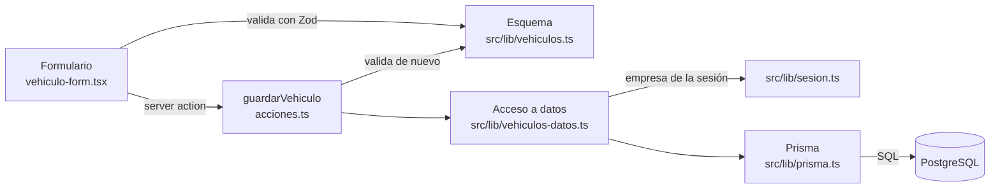

# JOS-06 · Manual técnico de MicroLogist

| | |
|---|---|
| **Tarea** | [JOS-06] Redactar manual técnico |
| **Responsable** | José Vargas (Developer). Aportan Simón Jofré y Joaquín Orellana. |
| **Revisión** | Simón Jofré y Joaquín Orellana |
| **Versión** | 0.1 · primera entrega en curso |
| **Fecha** | 16-10-2026 |

Este manual explica **cómo está construido MicroLogist y cómo se instala, configura, despliega y mantiene**. Está pensado para quien desarrolla o administra el sistema: el equipo, la profesora o quien continúe el proyecto. No es el manual de usuario: no explica cómo usar las pantallas.

Se actualiza en cada entrega (sección 12). Lo que todavía no está decidido o implementado se marca **[POR CONFIRMAR]** o **Pendiente**.

---

## 1. Resumen del sistema

MicroLogist es una aplicación web para pequeñas y medianas empresas de transporte de pasajeros: centraliza vehículos, conductores, turnos y documentos, y avisa por correo antes de que venzan los documentos.

| Módulo | Estado al 16-10-2026 |
|---|---|
| Vehículos: registrar, listar, buscar, editar, desactivar y reactivar | Implementado, con datos en PostgreSQL (JOS-02 y JOS-03) |
| Inicio y cierre de sesión | Pendiente (SIM-02) |
| Conductores, documentos, avisos por correo y turnos | Pendiente (MVP completo) |
| Ingresos | Opcional, pendiente |

Los requisitos están en [JOA-01](JOA-01_Reglas_Modulo_Vehiculos.md), [JOA-05](JOA-05_Requisitos_No_Funcionales.md) y el [Product Backlog](JOA-08_Product_Backlog.md).

---

## 2. Arquitectura

### 2.1 Componentes

| Componente | Tecnología | Dónde se ejecuta |
|---|---|---|
| Aplicación web (interfaz y servidor) | Next.js con App Router | Vercel (producción) o el computador (desarrollo) |
| Base de datos | PostgreSQL | Supabase (desarrollo y producción) o Docker (local) |
| Inicio de sesión | Supabase Auth | Supabase. Pendiente (SIM-02). |
| Envío de avisos | Proceso diario y proveedor de correo | Pendiente **[POR CONFIRMAR]** |

El diagrama general está en el [README](<../Evidencias de sistema/README.md#arquitectura>) y el diagrama de componentes en [JOA-06](JOA-06_Diagramas_UML.md), sección 4.

### 2.2 Cómo viaja una solicitud dentro del código

Ejemplo: guardar un vehículo.



Reglas de diseño que siguen todas las pantallas:

1. **Validación en dos lugares con el mismo esquema Zod:** en el navegador, para ayudar al usuario, y en el servidor, que es la que protege los datos.
2. **Todo el acceso a la base de datos pasa por `src/lib/*-datos.ts`.** Las páginas y acciones no usan Prisma directamente.
3. **El acceso a datos siempre filtra por la empresa de la sesión**, también al buscar por `id`. La empresa la entrega `empresaDeLaSesion()` y nunca viene del formulario.
4. **Lo que no es de la empresa responde 404**, no 403, para no revelar que existe.
5. **Los errores no muestran detalles técnicos** al usuario: se registran en el servidor (`console.error`) y la pantalla muestra un mensaje claro.

---

## 3. Tecnologías y versiones

| Tecnología | Versión | Uso |
|---|---|---|
| Node.js | 24 | Entorno de ejecución (el equipo usa 24) |
| Next.js | 16.3.6 | Framework web (App Router, server actions, Turbopack) |
| React | 19.2.8 | Interfaz |
| TypeScript | 5 | Lenguaje |
| Tailwind CSS | 4 | Estilos adaptables a computador y celular |
| Zod | 4 | Validación de datos |
| Prisma ORM | 7.10.1 | Esquema, migraciones y consultas. Usa el adaptador `@prisma/adapter-pg` con el driver `pg` |
| PostgreSQL | 17 en Docker; la versión de Supabase la define el proyecto | Base de datos |
| Supabase | Plan gratuito | Hospeda PostgreSQL y, desde SIM-02, el inicio de sesión |
| Vercel | **[POR CONFIRMAR]** | Despliegue |
| Docker | Docker Desktop | Entorno local opcional (JOS-05) |

Las versiones exactas están en `package.json` y `package-lock.json`. Prisma se fijó en 7.10.1 porque, al 16-10-2026, la etiqueta "latest" de su CLI apunta a una versión 8 en prueba.

---

## 4. Estructura del código

Desde el 18-10-2026, en la raíz del repositorio solo están las carpetas `Fase 1`, `Fase 2` y `Fase 3`. El sistema está en `Fase 2/Evidencias Proyecto/Evidencias de sistema`:

```
Evidencias de sistema/
├── README.md                     Descripción del proyecto e instrucciones para ejecutarlo
├── Base de datos/
│   ├── schema.prisma             Modelo de datos
│   ├── migrations/               Migraciones versionadas (scripts SQL)
│   └── README.md                 Qué contiene y cómo se usa
└── Aplicación/                   Desde aquí se ejecutan los comandos npm y Docker
    └── (estructura de abajo)
```

Dentro de `Aplicación`:

```
Aplicación/
├── src/
│   ├── app/                      Páginas y rutas (App Router)
│   │   ├── layout.tsx            Estructura común y menú
│   │   ├── page.tsx              "/" redirige a /vehiculos
│   │   ├── not-found.tsx         Página "No encontrado"
│   │   └── vehiculos/
│   │       ├── (listado)/        Listado (/vehiculos) y su pantalla de carga
│   │       ├── nuevo/            Registro (/vehiculos/nuevo)
│   │       ├── [id]/             Detalle y edición (/vehiculos/:id)
│   │       ├── acciones.ts       Server actions: guardar y cambiar estado
│   │       ├── error.tsx         Página de error sin detalles técnicos
│   │       └── *.tsx             Formulario, botón de activación e insignia de estado
│   ├── lib/
│   │   ├── vehiculos.ts          Esquema Zod, tipos y formato de patente
│   │   ├── vehiculos-datos.ts    Acceso a datos de vehículos (filtra por empresa)
│   │   ├── sesion.ts             Empresa de la sesión (SIM-02 la completa)
│   │   └── prisma.ts             Cliente de Prisma para la aplicación
│   └── generated/prisma/         Cliente generado por Prisma (no se sube al repositorio)
├── prisma/
│   ├── seed.ts                   Datos ficticios de prueba
│   └── comprobar.ts              Comprobación de la base de datos
├── tests/                        Pruebas automáticas
├── Capturas/                     Capturas de pantalla de la aplicación
├── Dockerfile, compose.yaml,     Entorno Docker (JOS-05)
│   iniciar.sh
├── prisma.config.ts              Configuración del CLI de Prisma (apunta a «Base de datos»)
└── .env.example                  Variables de entorno, sin valores secretos
```

Convenciones:

- **Nombres en español**, en el código y en la base de datos (`vehiculo`, `guardarVehiculo`). Código en camelCase; tablas y columnas en snake_case.
- **Un módulo nuevo** (por ejemplo, conductores) sigue el patrón de vehículos: `src/lib/conductores.ts` (esquema), `src/lib/conductores-datos.ts` (acceso a datos) y `src/app/conductores/` (pantallas y acciones).
- **Ramas y commits:** una rama por tarea (`jos-03-vehiculos-prisma`), commits que empiezan con el código de la tarea (`JOS-03: …`) y pull request revisado por otro integrante ([Definition of Done](SIM-05_Definition_of_Done.md)).

---

## 5. Instalación y configuración

Los pasos para instalar y ejecutar están en el [README](<../Evidencias de sistema/README.md#instrucciones-para-ejecutar-localmente>). Hay dos formas de trabajar:

| Forma | Base de datos | Cuándo usarla |
|---|---|---|
| `npm run dev` en el computador | Supabase (o la de Docker) | Para programar a diario |
| Docker (`docker compose up --build`, desde `Aplicación`) | PostgreSQL local, sin claves | Para levantar y revisar la aplicación sin credenciales ([JOS-05](JOS-05_Entorno_Docker.md)) |

### 5.1 Variables de entorno

Se definen en `.env` (desarrollo), en `Aplicación/compose.yaml` (Docker) o en el panel de Vercel (producción). El `.env` nunca se sube al repositorio.

| Variable | Para qué | Quién la usa | Desarrollo | Producción |
|---|---|---|---|---|
| `DATABASE_URL` | Conexión de la aplicación (Supabase: transaction pooler, puerto 6543, `?pgbouncer=true`) | `src/lib/prisma.ts` | Sí | Sí |
| `DIRECT_URL` | Conexión para migraciones, seed y comprobación (Supabase: session pooler, puerto 5432) | `prisma.config.ts`, `prisma/seed.ts`, `prisma/comprobar.ts` | Sí | Solo donde se ejecuten las migraciones |
| `EMPRESA_DESARROLLO_ID` | Empresa de trabajo mientras no existe el inicio de sesión | `src/lib/sesion.ts` | Sí | No: en producción no se usa |
| `NEXT_PUBLIC_SUPABASE_URL` | Dirección del proyecto de Supabase | Supabase Auth (SIM-02) | Pendiente | Pendiente |
| `NEXT_PUBLIC_SUPABASE_ANON_KEY` | Clave pública de Supabase | Supabase Auth (SIM-02) | Pendiente | Pendiente |

Cómo obtener las direcciones de Supabase: [JOS-02](JOS-02_Configuracion_Base_de_Datos.md), sección 3.

---

## 6. Base de datos y migraciones

| Tema | Dónde está |
|---|---|
| Configuración de Supabase, comandos, datos de prueba y seguridad | [JOS-02](JOS-02_Configuracion_Base_de_Datos.md) |
| Diagrama entidad-relación, diccionario de datos y separación entre empresas | [JOS-04](JOS-04_Modelo_de_Datos.md) |

Comandos principales:

| Comando | Para qué |
|---|---|
| `npm run db:deploy` | Aplica las migraciones pendientes |
| `npm run db:seed` | Carga los datos ficticios (se puede repetir) |
| `npm run db:comprobar` | Comprueba crear y consultar vehículos, sin dejar datos |
| `npm run db:migrate -- --name descripcion` | Crea una migración nueva después de cambiar el esquema |
| `npm run db:studio` | Abre Prisma Studio para ver las tablas |

Reglas al cambiar el modelo:

1. Editar `Base de datos/schema.prisma` y crear la migración con `npm run db:migrate` (desde `Aplicación`). La carpeta nueva de `Base de datos/migrations/` se sube en el mismo PR.
2. **Toda tabla nueva activa RLS en su migración** (`ALTER TABLE ... ENABLE ROW LEVEL SECURITY;`), como la migración inicial ([JOS-02](JOS-02_Configuracion_Base_de_Datos.md), sección 6).
3. Toda tabla con datos de una empresa tiene `empresa_id` obligatorio ([JOS-04](JOS-04_Modelo_de_Datos.md), sección 4).
4. Nunca se edita una migración que ya está en `main`: se corrige con una nueva.
5. Después de cambiar el esquema, `npx prisma generate` actualiza el cliente. `npm install` también lo ejecuta.

---

## 7. Pruebas y calidad

| Comando | Qué revisa |
|---|---|
| `npm test` | Pruebas automáticas con el runner de Node (`node --test`). Hoy cubren el esquema de vehículos con los casos de JOA-01 (9 pruebas en `tests/vehiculos.test.ts`). |
| `npm run lint` | Reglas de ESLint de Next.js |
| `npm run build` | Compila la aplicación; también revisa los tipos de TypeScript |
| `npm run db:comprobar` | Funcionamiento de la base de datos y de la separación entre empresas |

La Definition of Done exige que `build` y `lint` pasen antes de unir un PR ([SIM-05](SIM-05_Definition_of_Done.md), sección 3.1). El plan de pruebas completo lo define Simón en SIM-04 **[POR CONFIRMAR]**.

---

## 8. Despliegue y operación

### 8.1 Vercel (aplicación) · Pendiente

La aplicación todavía no está desplegada. Pasos previstos **[POR CONFIRMAR]**:

1. Importar el repositorio de GitHub en Vercel y poner como **Root Directory** `Fase 2/Evidencias Proyecto/Evidencias de sistema/Aplicación`, dejando activada la opción que incluye los archivos fuera de esa carpeta (Prisma necesita `../Base de datos`). Vercel detecta Next.js y usa `npm run build`. `npm install` ejecuta `prisma generate` automáticamente.
2. Configurar las variables de producción de la sección 5.1 en el panel de Vercel.
3. Aplicar las migraciones a la base de producción antes de cada despliegue que las incluya: `npm run db:deploy` con la `DIRECT_URL` de producción. Si esto se automatiza, se define al configurar Vercel.
4. Elegir para las funciones de Vercel una región cercana a la de la base de datos, para reducir la latencia (el proyecto de desarrollo de Supabase está en West US, Oregon).

Mientras no exista el inicio de sesión (SIM-02), `empresaDeLaSesion()` falla en producción a propósito, para no mostrar datos sin sesión. Por eso el primer despliegue útil requiere SIM-02.

### 8.2 Supabase (base de datos e inicio de sesión)

| Tema | Estado |
|---|---|
| Proyecto de desarrollo | `micrologist-dev`, plan gratuito, región West US (Oregon). Migrado y con datos de prueba. |
| Proyecto de producción | Si se usa uno separado del de desarrollo está **[POR CONFIRMAR]**. |
| Acceso del equipo | Si los tres comparten el proyecto de desarrollo está **[POR CONFIRMAR]** ([JOS-02](JOS-02_Configuracion_Base_de_Datos.md), sección 3). |
| Respaldos | Según el plan de Supabase **[POR CONFIRMAR]** (RNF-DIS-03). |
| Supabase Auth | Pendiente (SIM-02). El `id` de la tabla `usuario` es el de Supabase Auth. |

Si una contraseña de la base de datos se filtra o hay que cambiarla: Supabase → **Project Settings → Database → Reset database password**, y luego actualizar `DATABASE_URL` y `DIRECT_URL` en cada `.env` y en Vercel. La contraseña va sin corchetes dentro de la URL.

### 8.3 Avisos por correo · Pendiente

Se implementa con el módulo de documentos (PB-15 y PB-16). Quedan por definir **[POR CONFIRMAR]**: el proveedor de correo (por ejemplo, Resend o SMTP), el programador del proceso diario (por ejemplo, Vercel Cron), la hora del envío en hora de Chile y las variables de entorno nuevas, que se agregarán a la sección 5.1 y a `.env.example`. El modelo del registro de envíos ya está propuesto en [JOS-04](JOS-04_Modelo_de_Datos.md), sección 3.7.

### 8.4 Operación diaria

- **Registros de errores:** en desarrollo, en la terminal de `npm run dev`; en producción, en los logs de Vercel. Las acciones registran el error con `console.error` y al usuario le muestran un mensaje sin detalles.
- **Monitoreo de disponibilidad:** **[POR CONFIRMAR]** (RNF-DIS-01).
- **Dependencias:** revisar `npm audit --omit=dev` antes de cada entrega (RNF-SEG-10).

---

## 9. Seguridad

| Medida | Dónde |
|---|---|
| Credenciales solo en variables de entorno; `.env` fuera del repositorio y fuera de las imágenes de Docker | `.gitignore`, `Dockerfile.dockerignore` |
| La empresa se toma de la sesión y todas las consultas filtran por ella | `src/lib/sesion.ts`, `src/lib/vehiculos-datos.ts` |
| Validación en el servidor con Zod | `src/lib/vehiculos.ts`, `acciones.ts` |
| Patente única por empresa garantizada por la base de datos | Restricción `(empresa_id, patente)` |
| La API pública de Supabase no puede leer las tablas (RLS activo sin políticas) | Migración inicial |
| Contraseñas de usuarios fuera de nuestras tablas | Supabase Auth (SIM-02) |
| Errores sin detalles técnicos | `src/app/vehiculos/error.tsx` |

**Pendiente conocido:** al 16-10-2026, `npm audit --omit=dev` informa 3 vulnerabilidades altas (`next` 16.3.6, `sharp` y `source-map-js`). Se corrigen actualizando Next.js a 16.4 y ejecutando `npm audit fix` (sección 10).

---

## 10. Mejoras técnicas pendientes

| Mejora | Motivo |
|---|---|
| Actualizar Next.js a 16.4 y `npm audit fix` | Cumplir RNF-SEG-10 (sección 9) |
| `engines.node` a `>=24` y `@types/node` a `^24` en `package.json` | Hoy dice `>=20.9.0`, pero el equipo usa Node 24 y `npm test` necesita una versión que tenga `--experimental-strip-types` |
| Integración continua con GitHub Actions (lint, pruebas y build en cada PR) | Automatizar los chequeos de la Definition of Done |

---

## 11. Problemas frecuentes

| Síntoma | Causa y solución |
|---|---|
| La página se ve vacía con la dirección "Network" | Next.js bloquea esa dirección en desarrollo. Usar `http://localhost:3000`. |
| `P1001: Can't reach database server` | Revisar la conexión a internet y las direcciones del `.env`. |
| `password authentication failed` | La contraseña del `.env` no coincide. Revisar que no quedaron los corchetes de `[YOUR-PASSWORD]`. |
| `Cannot find module '@/generated/prisma/client'` | Falta generar el cliente: `npx prisma generate` (o `npm install`). |
| Prisma no encuentra las variables | Prisma no lee el `.env` solo: lo carga `prisma.config.ts` con `dotenv`. Ejecutar los comandos desde la carpeta `Aplicación`. |
| La aplicación muestra "No pudimos cargar los vehículos" | Revisar en la terminal el error real. En desarrollo, comprobar `EMPRESA_DESARROLLO_ID` y la conexión a la base de datos. |
| Problemas con Docker | [JOS-05](JOS-05_Entorno_Docker.md), sección 5. |

---

## 12. Historial de versiones

| Versión | Fecha | Cambios |
|---|---|---|
| 0.1 | 16-10-2026 | Primera versión: arquitectura, estructura, instalación, variables, base de datos, pruebas, despliegue previsto y seguridad. Módulo de vehículos con base de datos; inicio de sesión pendiente. |

En cada entrega se actualizan las secciones 1, 5.1, 8 y 9, y se agrega una fila a esta tabla.

---

## 13. Checklist de JOS-06

- [x] Arquitectura, tecnologías y estructura del código (secciones 2 a 4).
- [x] Instalación, configuración, variables de entorno, base de datos y migraciones (secciones 5 y 6).
- [x] Despliegue y operación con Vercel, Supabase y el servicio de correo, marcando lo pendiente (sección 8).
- [x] Separado del manual de usuario y con historial para actualizarlo en cada entrega (sección 12).
- [ ] Aportes de Simón (inicio de sesión y plan de pruebas) y de Joaquín cuando correspondan.
- [ ] Revisión del equipo en el PR.
