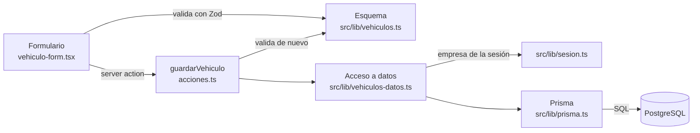

# JOS-06 · Manual técnico de MicroLogist

| | |
|---|---|
| **Tarea** | [JOS-06] Redactar manual técnico |
| **Responsable** | José Vargas (Developer). Aportan Simón Jofré y Joaquín Orellana. |
| **Revisión** | Simón Jofré y Joaquín Orellana |
| **Versión** | 0.2 |
| **Fecha** | 16-10-2026 (actualizado el 09-11-2026) |

Este manual explica **cómo está construido MicroLogist y cómo se instala, configura, despliega y mantiene**. Está pensado para quien desarrolla o administra el sistema: el equipo, la profesora o quien continúe el proyecto. No es el manual de usuario: no explica cómo usar las pantallas.

Se actualiza en cada entrega (sección 12). Lo que todavía no está decidido o implementado se marca **[POR CONFIRMAR]** o **Pendiente**.

---

## 1. Resumen del sistema

MicroLogist es una aplicación web para pequeñas y medianas empresas de transporte de pasajeros: centraliza vehículos, conductores, turnos y documentos, y avisa por correo antes de que venzan los documentos.

| Módulo | Estado al 09-11-2026 |
|---|---|
| Vehículos: registrar, listar, buscar, editar, desactivar y reactivar | Implementado, con datos en PostgreSQL (JOS-02 y JOS-03) |
| Inicio y cierre de sesión con Supabase Auth | Implementado ([SIM-02](SIM-02_Inicio_de_Sesion.md)) |
| Conductores: registrar, listar, buscar, editar, desactivar y reactivar | Implementado y probado ([SIM-08](SIM-08_Pruebas_Conductores.md)) |
| Conductor asignado al vehículo (PB-24) | Implementado; faltan sus casos en el plan de pruebas |
| Mi empresa: datos de contacto | Implementado (JOA-15) |
| Documentos: registrar, listar y editar, y su sección en la ficha del vehículo y del conductor | Implementado; faltan sus pruebas con Supabase |
| Avisos por correo antes del vencimiento | Implementado ([SIM-11](SIM-11_Alertas_por_Correo.md)); falta configurar Resend y probar un envío real |
| Turnos | Trabajo futuro: fuera de la entrega final ([JOA-08](JOA-08_Product_Backlog.md)) |
| Ingresos | Opcional, trabajo futuro |

La aplicación está publicada en `https://micrologist-equipo09.vercel.app` (sección 8.1). Los requisitos están en [JOA-01](JOA-01_Reglas_Modulo_Vehiculos.md), [JOA-05](JOA-05_Requisitos_No_Funcionales.md) y el [Product Backlog](JOA-08_Product_Backlog.md).

---

## 2. Arquitectura

### 2.1 Componentes

| Componente | Tecnología | Dónde se ejecuta |
|---|---|---|
| Aplicación web (interfaz y servidor) | Next.js con App Router | Vercel (producción) o el computador (desarrollo) |
| Base de datos | PostgreSQL | Supabase (desarrollo y producción) o Docker (local) |
| Inicio de sesión | Supabase Auth, con la sesión en cookies (`@supabase/ssr`) | Supabase ([SIM-02](SIM-02_Inicio_de_Sesion.md)) |
| Envío de avisos | Proceso diario (`GET /api/avisos`) y envío con Resend | Vercel Cron lo llama una vez al día ([SIM-11](SIM-11_Alertas_por_Correo.md)) |
| Pruebas y despliegue | GitHub Actions y la CLI de Vercel | GitHub, en cada PR y en cada push a `main` ([SIM-10](SIM-10_Despliegue_Vercel.md)) |

El diagrama general está en el [README](<../../../README.md#arquitectura>) y el diagrama de componentes en [JOA-06](JOA-06_Diagramas_UML.md), sección 4.

### 2.2 Cómo viaja una solicitud dentro del código

Ejemplo: guardar un vehículo.



Reglas de diseño que siguen todas las pantallas:

1. **Validación en dos lugares con el mismo esquema Zod:** en el navegador, para ayudar al usuario, y en el servidor, que es la que protege los datos.
2. **Todo el acceso a la base de datos pasa por `src/lib/*-datos.ts`.** Las páginas y acciones no usan Prisma directamente.
3. **El acceso a datos siempre filtra por la empresa de la sesión**, también al buscar por `id`. La empresa la entrega `empresaDeLaSesion()` y nunca viene del formulario.
4. **Lo que no es de la empresa responde 404**, no 403, para no revelar que existe.
5. **Los errores no muestran detalles técnicos** al usuario: se registran en el servidor (`console.error`) y la pantalla muestra un mensaje claro.

---

## 3. Tecnologías y versiones

| Tecnología | Versión | Uso |
|---|---|---|
| Node.js | 24 | Entorno de ejecución (el equipo usa 24) |
| Next.js | 16.4.4 | Framework web (App Router, server actions, Turbopack) |
| React | 19.2.8 | Interfaz |
| TypeScript | 5 | Lenguaje |
| Tailwind CSS | 4 | Estilos adaptables a computador y celular |
| Zod | 4 | Validación de datos |
| Prisma ORM | 7.10.1 | Esquema, migraciones y consultas. Usa el adaptador `@prisma/adapter-pg` con el driver `pg` |
| PostgreSQL | 17 en Docker; la versión de Supabase la define el proyecto | Base de datos |
| Supabase | Plan gratuito | Hospeda PostgreSQL y, desde SIM-02, el inicio de sesión |
| Vercel | Plan Hobby | Despliegue, con la CLI de Vercel desde GitHub Actions (SIM-10) |
| GitHub Actions | `.github/workflows/vercel.yml` | Lint, tipos y pruebas en cada PR, y publicación en Vercel |
| Resend | API HTTP, plan gratuito | Envío de los avisos por correo (SIM-11) |
| Docker | Docker Desktop | Entorno local opcional (JOS-05) |

Las versiones exactas están en `package.json` y `package-lock.json`. Prisma se fijó en 7.10.1 porque, al 16-10-2026, la etiqueta "latest" de su CLI apunta a una versión 8 en prueba.

---

## 4. Estructura del código

En la raíz del repositorio están las carpetas `Fase 1`, `Fase 2` y `Fase 3`, el `README.md` con la descripción del proyecto y las instrucciones para ejecutarlo, y `.github/workflows/vercel.yml`, la GitHub Action de pruebas y despliegue (va en la raíz porque GitHub la busca ahí). El sistema está en `Fase 2/Evidencias Proyecto/Evidencias de sistema`:

```
Evidencias de sistema/
├── Base de datos/
│   ├── migrations/               Migraciones versionadas (scripts SQL)
│   └── README.md                 Qué contiene y cómo se usa
└── Aplicación/                   Desde aquí se ejecutan los comandos npm y Docker
    └── (estructura de abajo)
```

Dentro de `Aplicación`:

```
Aplicación/
├── src/
│   ├── app/                      Páginas y rutas (App Router)
│   │   ├── layout.tsx            Estructura común y menú
│   │   ├── menu-sesion.tsx       Encabezado: empresa y «Cerrar sesión»
│   │   ├── page.tsx              "/" redirige a /vehiculos
│   │   ├── not-found.tsx         Página "No encontrado"
│   │   ├── login/                Inicio y cierre de sesión (/login)
│   │   ├── vehiculos/
│   │   │   ├── (listado)/        Listado (/vehiculos) y su pantalla de carga
│   │   │   ├── nuevo/            Registro (/vehiculos/nuevo)
│   │   │   ├── [id]/             Detalle y edición (/vehiculos/:id)
│   │   │   ├── acciones.ts       Server actions: guardar y cambiar estado
│   │   │   ├── error.tsx         Página de error sin detalles técnicos
│   │   │   └── *.tsx             Formulario, botón de activación e insignia de estado
│   │   ├── conductores/          Igual que vehículos (/conductores)
│   │   ├── documentos/           Igual que vehículos (/documentos)
│   │   ├── empresa/              Mi empresa: datos de contacto (/empresa)
│   │   └── api/avisos/           Proceso diario de avisos (GET /api/avisos, con CRON_SECRET)
│   ├── lib/
│   │   ├── vehiculos.ts          Esquema Zod, tipos y formato de patente
│   │   ├── vehiculos-datos.ts    Acceso a datos de vehículos (filtra por empresa)
│   │   ├── conductores*.ts       Lo mismo para conductores (esquema, datos y filtros)
│   │   ├── empresa*.ts           Lo mismo para Mi empresa
│   │   ├── sesion.ts             Usuario y empresa de la sesión
│   │   ├── acceso.ts             Reglas del inicio de sesión y modo de acceso
│   │   ├── supabase.ts           Cliente de Supabase (solo para la autenticación)
│   │   ├── seguridad.ts          Encabezados de seguridad HTTP
│   │   ├── documentos*.ts        Lo mismo para documentos (esquema, estado, datos y filtros)
│   │   ├── avisos*.ts            Reglas y proceso diario de los avisos por correo
│   │   ├── correo.ts             Envío con la API de Resend
│   │   ├── rut.ts, fechas.ts     RUT chileno y fechas en hora de Chile
│   │   └── prisma.ts             Cliente de Prisma para la aplicación
│   ├── proxy.ts                  Sin sesión, redirige a /login antes de cada página
│   └── generated/prisma/         Cliente generado por Prisma (no se sube al repositorio)
├── prisma/
│   ├── schema.prisma             Modelo de datos
│   ├── seed.ts                   Datos ficticios de prueba
│   └── comprobar.ts              Comprobación de la base de datos
├── tests/                        Pruebas automáticas
├── Capturas/                     Capturas de pantalla de la aplicación
├── Dockerfile, compose.yaml,     Entorno Docker (JOS-05)
│   iniciar.sh
├── prisma.config.ts              Configuración del CLI de Prisma (migraciones en «Base de datos»)
├── vercel.json                   Programación diaria de los avisos (Vercel Cron)
└── .env.example                  Variables de entorno, sin valores secretos
```

Convenciones:

- **Nombres en español**, en el código y en la base de datos (`vehiculo`, `guardarVehiculo`). Código en camelCase; tablas y columnas en snake_case.
- **Un módulo nuevo** (por ejemplo, turnos) sigue el patrón de vehículos, conductores y documentos: `src/lib/turnos.ts` (esquema), `src/lib/turnos-datos.ts` (acceso a datos) y `src/app/turnos/` (pantallas y acciones).
- **Ramas y commits:** una rama por tarea (`jos-03-vehiculos-prisma`), commits que empiezan con el código de la tarea (`JOS-03: …`) y pull request revisado por otro integrante ([Definition of Done](SIM-05_Definition_of_Done.md)).

---

## 5. Instalación y configuración

Los pasos para instalar y ejecutar están en el [README](<../../../README.md#instrucciones-para-ejecutar-localmente>). Hay dos formas de trabajar:

| Forma | Base de datos | Cuándo usarla |
|---|---|---|
| `npm run dev` en el computador | Supabase (o la de Docker) | Para programar a diario |
| Docker (`docker compose up --build`, desde `Aplicación`) | PostgreSQL local, sin claves | Para levantar y revisar la aplicación sin credenciales ([JOS-05](JOS-05_Entorno_Docker.md)) |

### 5.1 Variables de entorno

Se definen en `.env` (desarrollo), en `Aplicación/compose.yaml` (Docker) o en el panel de Vercel. En Vercel, el entorno **Production** usa las de `micrologist-prod` y el entorno **Preview** (las vistas previas de los PR) las de `micrologist-dev`, para que el código de un PR nunca escriba en la base de producción. El `.env` nunca se sube al repositorio.

| Variable | Para qué | Quién la usa | Desarrollo | Producción |
|---|---|---|---|---|
| `DATABASE_URL` | Conexión de la aplicación (Supabase: transaction pooler, puerto 6543, `?pgbouncer=true`) | `src/lib/prisma.ts` | Sí | Sí |
| `DIRECT_URL` | Conexión para migraciones, seed y comprobación (Supabase: session pooler, puerto 5432) | `prisma.config.ts`, `prisma/seed.ts`, `prisma/comprobar.ts` | Sí | Solo donde se ejecuten las migraciones |
| `EMPRESA_DESARROLLO_ID` | Empresa con la que se trabaja sin Supabase Auth (modo desarrollo, por ejemplo en Docker) | `src/lib/acceso.ts` | Solo si faltan las dos variables de Supabase | No: en producción no se usa |
| `NEXT_PUBLIC_SUPABASE_URL` | Dirección del proyecto de Supabase (*Project URL*) | Inicio de sesión (`src/lib/acceso.ts`) | Sí, para iniciar sesión | Sí |
| `NEXT_PUBLIC_SUPABASE_ANON_KEY` | Clave pública (*anon*) de Supabase; la clave `service_role` nunca se usa | Inicio de sesión (`src/lib/acceso.ts`) | Sí, para iniciar sesión | Sí |
| `RESEND_API_KEY` | Clave para enviar correos con Resend | `src/lib/correo.ts` | Solo para probar los avisos | Sí, para enviar avisos |
| `CORREO_REMITENTE` | Remitente de los avisos; sin dominio propio, `MicroLogist <onboarding@resend.dev>` | `src/lib/correo.ts` | Solo para probar los avisos | Sí, para enviar avisos |
| `CRON_SECRET` | Clave que Vercel Cron envía al llamar `/api/avisos`; sin ella, la ruta responde 401 | `src/app/api/avisos/route.ts` | Solo para probar los avisos | Sí, para enviar avisos |

Las dos variables de Supabase van juntas. Con las dos, se pide iniciar sesión, también en desarrollo. Sin ninguna, en desarrollo se trabaja con `EMPRESA_DESARROLLO_ID`. Con una sola, o sin ellas en producción, la aplicación no muestra datos ([SIM-02](SIM-02_Inicio_de_Sesion.md), sección 3).

Cómo obtener las direcciones de la base de datos: [JOS-02](JOS-02_Configuracion_Base_de_Datos.md), sección 3. La dirección y la clave pública de Supabase Auth: [SIM-02](SIM-02_Inicio_de_Sesion.md), sección 5. Las tres de los avisos: [SIM-11](SIM-11_Alertas_por_Correo.md), sección 3.

---

## 6. Base de datos y migraciones

| Tema | Dónde está |
|---|---|
| Configuración de Supabase, comandos, datos de prueba y seguridad | [JOS-02](JOS-02_Configuracion_Base_de_Datos.md) |
| Diagrama entidad-relación, diccionario de datos y separación entre empresas | [JOS-04](JOS-04_Modelo_de_Datos.md) |

Comandos principales:

| Comando | Para qué |
|---|---|
| `npm run db:deploy` | Aplica las migraciones pendientes |
| `npm run db:seed` | Carga los datos ficticios (se puede repetir) |
| `npm run db:comprobar` | Comprueba crear y consultar vehículos, sin dejar datos |
| `npm run db:migrate -- --name descripcion` | Crea una migración nueva después de cambiar el esquema |
| `npm run db:studio` | Abre Prisma Studio para ver las tablas |

Reglas al cambiar el modelo:

1. Editar `prisma/schema.prisma` y crear la migración con `npm run db:migrate` (desde `Aplicación`). La carpeta nueva de `Base de datos/migrations/` se sube en el mismo PR.
2. **Toda tabla nueva activa RLS en su migración** (`ALTER TABLE ... ENABLE ROW LEVEL SECURITY;`), como la migración inicial ([JOS-02](JOS-02_Configuracion_Base_de_Datos.md), sección 6).
3. Toda tabla con datos de una empresa tiene `empresa_id` obligatorio ([JOS-04](JOS-04_Modelo_de_Datos.md), sección 4).
4. Nunca se edita una migración que ya está en `main`: se corrige con una nueva.
5. Después de cambiar el esquema, `npx prisma generate` actualiza el cliente. `npm install` también lo ejecuta.

---

## 7. Pruebas y calidad

| Comando | Qué revisa |
|---|---|
| `npm test` | Pruebas automáticas con el runner de Node (`node --test`). Hoy son 120 en `tests/`: vehículos, conductores, Mi empresa, documentos y sus filtros, avisos, envío de correo, inicio de sesión, RUT, fechas y encabezados de seguridad. |
| `npm run test:integracion` | Pruebas con la base de datos real y con la aplicación levantada (38 en `tests/integracion/`). Usan el `.env` ([SIM-04](SIM-04_Plan_de_Pruebas.md), sección 6.6). |
| `npm run lint` | Reglas de ESLint de Next.js |
| `npm run build` | Compila la aplicación; también revisa los tipos de TypeScript |
| `npm run db:comprobar` | Funcionamiento de la base de datos y de la separación entre empresas |

La Definition of Done exige que `build` y `lint` pasen antes de unir un PR ([SIM-05](SIM-05_Definition_of_Done.md), sección 3.1). Desde el PR #62, la GitHub Action lo revisa sola en cada PR: lint, tipos, `npm test` y el build. Las pruebas de integración se siguen ejecutando en local, porque necesitan una base de datos. El plan de pruebas completo está en [SIM-04](SIM-04_Plan_de_Pruebas.md).

---

## 8. Despliegue y operación

### 8.1 Vercel (aplicación)

Publicada en `https://micrologist-equipo09.vercel.app` desde el 05-11-2026, en el proyecto `micrologist-equipo09` de Vercel ([SIM-10](SIM-10_Despliegue_Vercel.md)). Cómo funciona:

1. El proyecto de Vercel **no se conecta con GitHub**: Vercel nombra las funciones con la ruta desde la raíz del repositorio, que tiene espacios (`Fase 2/…`), y el build falla. La aplicación la construye y publica la GitHub Action `.github/workflows/vercel.yml`, con la CLI de Vercel y desde la carpeta `Aplicación`: una vista previa en cada PR y producción en cada push a `main` ([SIM-10](SIM-10_Despliegue_Vercel.md), secciones 4.3 y 4.5). El esquema de Prisma está dentro de `Aplicación` para que el build no necesite nada de fuera. `npm install` ejecuta `prisma generate` automáticamente.
2. Para publicar, la Action necesita los secretos `VERCEL_TOKEN`, `VERCEL_ORG_ID` y `VERCEL_PROJECT_ID` en GitHub (**Settings > Secrets and variables > Actions**). Sin ellos igual construye y revisa, pero no publica. Para volver a publicar sin un PR: **Actions > Pruebas y despliegue en Vercel > Run workflow**.
3. Las variables de la sección 5.1 están en el panel de Vercel, en Production y en Preview. Si se cambia una, hay que volver a publicar para que se aplique.
4. La Action no aplica migraciones. Si un PR trae una migración nueva, se aplica en producción **antes** de unirlo: `npm run db:deploy` con la `DIRECT_URL` de producción ([SIM-10](SIM-10_Despliegue_Vercel.md), sección 4.2).
5. Las funciones de Vercel van en una región cercana a la de la base de datos, para reducir la latencia (el proyecto de producción de Supabase está en East US, Ohio, así que corresponde Cleveland, `cle1`; [SIM-10](SIM-10_Despliegue_Vercel.md), sección 4.3).

En producción, la aplicación necesita las dos variables de Supabase del proyecto de producción: sin ellas no muestra datos, a propósito ([SIM-02](SIM-02_Inicio_de_Sesion.md), sección 3). En `micrologist-prod` se repitió la configuración de Supabase Auth de SIM-02 (sección 5): registro público desactivado, contraseña de 8 caracteres o más, y las dos cuentas de prueba con su perfil en `usuario`. Una cuenta nueva solo puede entrar si tiene su perfil en esa misma base.

### 8.2 Supabase (base de datos e inicio de sesión)

| Tema | Estado |
|---|---|
| Proyecto de desarrollo | `micrologist-dev`, plan gratuito, región West US (Oregon). Migrado y con datos de prueba. |
| Proyecto de producción | `micrologist-prod`, aparte del de desarrollo (acordado el 27-10-2026), plan gratuito, región East US (Ohio). Con las mismas migraciones que desarrollo ([SIM-10](SIM-10_Despliegue_Vercel.md), sección 4.2). |
| Acceso del equipo | Los tres comparten el proyecto de desarrollo (acordado el 27-10-2026; [JOS-02](JOS-02_Configuracion_Base_de_Datos.md), sección 3). |
| Respaldos | Según el plan de Supabase **[POR CONFIRMAR]** (RNF-DIS-03). |
| Supabase Auth | Configurado en el proyecto de desarrollo el 19-10-2026 (SIM-02) y de la misma forma en el de producción (SIM-10): inicio con correo y contraseña, registro público desactivado, contraseña de 8 caracteres o más, y una cuenta de prueba para la Empresa A y otra para la B, cada una con su perfil en `usuario`. El `id` de la tabla `usuario` es el de Supabase Auth. |

Si una contraseña de la base de datos se filtra o hay que cambiarla: Supabase → **Project Settings → Database → Reset database password**, y luego actualizar `DATABASE_URL` y `DIRECT_URL` en cada `.env` y en Vercel. La contraseña va sin corchetes dentro de la URL.

### 8.3 Avisos por correo

Implementados en [SIM-11](SIM-11_Alertas_por_Correo.md) (PB-15 y PB-16):

- **Cuándo:** Vercel Cron llama `GET /api/avisos` todos los días a las 11:00 UTC (`vercel.json`), con la clave `CRON_SECRET`. Sin ella, la ruta responde 401 y no hace nada.
- **Qué hace:** con la fecha de hoy en hora de Chile, busca los documentos que vencen dentro de 30 días y arma **un correo por empresa**, que envía con Resend a su correo de contacto (Mi empresa).
- **Registro:** cada aviso queda en la tabla `aviso_enviado`, como `enviado` o `fallido` ([JOS-04](JOS-04_Modelo_de_Datos.md), sección 3.7). Un aviso fallido se reintenta al día siguiente.
- **Pendiente:** crear la cuenta de Resend, cargar sus variables en Vercel (sección 5.1) y probar un envío real.

### 8.4 Operación diaria

- **Registros de errores:** en desarrollo, en la terminal de `npm run dev`; en producción, en los logs de Vercel. Las acciones registran el error con `console.error` y al usuario le muestran un mensaje sin detalles.
- **Monitoreo de disponibilidad:** **[POR CONFIRMAR]** (RNF-DIS-01).
- **Dependencias:** revisar `npm audit --omit=dev` antes de cada entrega (RNF-SEG-10).

---

## 9. Seguridad

| Medida | Dónde |
|---|---|
| Credenciales solo en variables de entorno; `.env` fuera del repositorio y fuera de las imágenes de Docker | `.gitignore`, `Dockerfile.dockerignore` |
| Solo con sesión: el proxy redirige a `/login`, y cada página y acción vuelve a validar la sesión contra Supabase Auth | `src/proxy.ts`, `src/lib/sesion.ts` |
| La empresa se toma de la sesión y todas las consultas filtran por ella | `src/lib/sesion.ts` y los `src/lib/*-datos.ts` |
| Validación en el servidor con Zod | `src/lib/vehiculos.ts`, `src/lib/conductores.ts`, `src/lib/documentos.ts`, `src/lib/empresa.ts` y los `acciones.ts` |
| El proceso de avisos solo se ejecuta con la clave `CRON_SECRET`; sin ella responde 401 | `src/app/api/avisos/route.ts`, `src/lib/avisos.ts` |
| Las vistas previas de los PR usan la base de desarrollo, nunca la de producción | Variables de Preview en Vercel (sección 5.1) |
| Patente y RUT del conductor únicos por empresa, garantizados por la base de datos | Restricciones `(empresa_id, patente)` y `(empresa_id, rut)` |
| La API pública de Supabase no puede leer las tablas (RLS activo sin políticas) | Migración de cada tabla |
| Contraseñas fuera de nuestras tablas y el mismo mensaje si el correo no existe o la contraseña es incorrecta | Supabase Auth; `mensajeDeErrorDeAcceso()` en `src/lib/acceso.ts` |
| Encabezados de seguridad (CSP, HSTS y otros) y sin `X-Powered-By` | `src/lib/seguridad.ts`, `next.config.ts` |
| Errores sin detalles técnicos | `error.tsx` de vehículos, conductores, documentos y Mi empresa |

**Dependencias al día (JOS-07, 02-11-2026):** se actualizaron Next.js y `eslint-config-next` de 16.3.6 a 16.4.4 y `zod` a 4.6.7, y se ejecutó `npm audit fix` (sin `--force`). No basta con cualquier 16.4: hasta la 16.4.0, Next.js tiene 2 vulnerabilidades críticas de ejecución remota de código. `npm audit --omit=dev` informa 0 vulnerabilidades, lo que cumple CP-SEG-13 y cierra ERR-01 de [SIM-04](SIM-04_Plan_de_Pruebas.md). `npm audit` completo informa 16 vulnerabilidades moderadas, todas en herramientas de desarrollo: vienen de `minimatch` ([GHSA-g3hv-75wg-m249](https://github.com/advisories/GHSA-g3hv-75wg-m249), publicado el 30-10-2026), que llega a través de ESLint y no forma parte de la aplicación en producción. No se usa `npm audit fix --force` porque propone bajar ESLint a la versión 4.

---

## 10. Mejoras técnicas pendientes

| Mejora | Motivo |
|---|---|
| `engines.node` a `>=24` y `@types/node` a `^24` en `package.json` | Hoy dice `>=20.9.0`, pero el equipo usa Node 24 (también la GitHub Action) y `npm test` necesita una versión que tenga `--experimental-strip-types` |
| Ejecutar las pruebas de integración en la GitHub Action, con una base de datos de prueba | Hoy solo se ejecutan en local, porque necesitan una base de datos |

---

## 11. Problemas frecuentes

| Síntoma | Causa y solución |
|---|---|
| La página se ve vacía con la dirección "Network" | Next.js bloquea esa dirección en desarrollo. Usar `http://localhost:3000`. |
| `P1001: Can't reach database server` | Revisar la conexión a internet y las direcciones del `.env`. |
| `password authentication failed` | La contraseña del `.env` no coincide. Revisar que no quedaron los corchetes de `[YOUR-PASSWORD]`. |
| `Cannot find module '@/generated/prisma/client'`, o TypeScript no reconoce una tabla nueva | Falta generar el cliente: `npx prisma generate` (o `npm install`). Pasa después de bajar una migración nueva. |
| Después de actualizar Next.js, `npm run build` dice `Cannot find module '@tailwindcss/postcss'` | Quedó la caché de la versión anterior. Borrar la carpeta `.next` y compilar de nuevo. |
| ESLint o Tailwind "no existen" después de `npm audit fix --omit=dev` | Ese comando quita de `node_modules` las dependencias de desarrollo. Ejecutar `npm install` para recuperarlas. |
| Prisma no encuentra las variables | Prisma no lee el `.env` solo: lo carga `prisma.config.ts` con `dotenv`. Ejecutar los comandos desde la carpeta `Aplicación`. |
| La aplicación muestra "No pudimos cargar los vehículos" | Revisar en la terminal el error real. En desarrollo, comprobar `EMPRESA_DESARROLLO_ID` y la conexión a la base de datos. |
| En Vercel, el build falla con "A Serverless Function has an invalid name" | Vercel está construyendo directo desde GitHub, con la ruta `Fase 2/…`, que tiene espacios. Desconectar el repositorio en Vercel (**Project Settings > Git**) y publicar con la GitHub Action ([SIM-10](SIM-10_Despliegue_Vercel.md), sección 4.3). |
| En producción, después de iniciar sesión: `P1000` o "Authentication failed against the database server" | La `DATABASE_URL` de Vercel tiene una contraseña que no es la de ese proyecto, o quedaron los corchetes. Corregirla y volver a publicar con **Run workflow**. |
| "Tu cuenta no tiene una empresa asignada" | La cuenta no tiene perfil en la tabla `usuario` de esa base. Ejecutar `Base de datos/perfiles-prueba.sql` en ese proyecto, y revisar que `NEXT_PUBLIC_SUPABASE_URL` y `DATABASE_URL` sean del mismo proyecto de Supabase. |
| Problemas con Docker | [JOS-05](JOS-05_Entorno_Docker.md), sección 5. |

---

## 12. Historial de versiones

| Versión | Fecha | Cambios |
|---|---|---|
| 0.1 | 16-10-2026 | Primera versión: arquitectura, estructura, instalación, variables, base de datos, pruebas, despliegue previsto y seguridad. Módulo de vehículos con base de datos; inicio de sesión pendiente. |
| 0.1.1 | 02-11-2026 | JOS-07: Next.js 16.4.4 y dependencias de producción sin vulnerabilidades (cierra ERR-01). Dos problemas frecuentes nuevos y uno ampliado. |
| 0.2 | 09-11-2026 | Inicio de sesión con Supabase Auth (SIM-02) en las secciones 1, 2.1, 4, 5.1, 8 y 9. Estado de los módulos, estructura del código y pruebas al día: conductores, conductor asignado, documentos, Mi empresa y avisos por correo (SIM-11). Despliegue publicado con la GitHub Action (SIM-10), variables de Production y Preview, y tres problemas frecuentes nuevos. |

En cada entrega se actualizan las secciones 1, 5.1, 8 y 9, y se agrega una fila a esta tabla.

---

## 13. Checklist de JOS-06

- [x] Arquitectura, tecnologías y estructura del código (secciones 2 a 4).
- [x] Instalación, configuración, variables de entorno, base de datos y migraciones (secciones 5 y 6).
- [x] Despliegue y operación con Vercel, Supabase y el servicio de correo, marcando lo pendiente (sección 8).
- [x] Separado del manual de usuario y con historial para actualizarlo en cada entrega (sección 12).
- [ ] Aportes de Simón (inicio de sesión y plan de pruebas) y de Joaquín cuando correspondan.
- [ ] Revisión del equipo en el PR.
