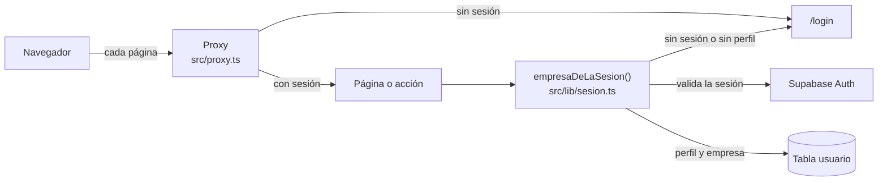

# SIM-02 · Inicio y cierre de sesión con Supabase Auth

| | |
|---|---|
| **Tarea** | [SIM-02] Inicio y cierre de sesión con Supabase Auth |
| **Responsable** | Simón Jofré (Scrum Master) |
| **Revisión** | José Vargas (código y relación usuario–empresa) y Joaquín Orellana (criterios de JOA-01) |
| **Estado** | Propuesta para revisión del equipo |
| **Fecha** | 16-10-2026 (actualizado el 28-10-2026) |

Este documento explica cómo funciona el inicio de sesión de MicroLogist, qué decisiones se tomaron y cómo configurarlo. Cubre los ítems **PB-01**, **PB-02** y **PB-03** del [Product Backlog](JOA-08_Product_Backlog.md) y los criterios 7.1 a 7.4 de [JOA-01](JOA-01_Reglas_Modulo_Vehiculos.md). Las pruebas formales con dos empresas las hace **SIM-03**. Lo marcado como **[POR CONFIRMAR]** todavía no es una decisión del equipo.

---

## 1. Qué incluye

- Pantalla de inicio de sesión en `/login`, con correo y contraseña.
- Botón **Cerrar sesión** en el encabezado.
- Redirección al inicio de sesión cuando no hay sesión.
- `empresaDeLaSesion()` (`src/lib/sesion.ts`) con Supabase Auth: la empresa sale del perfil del usuario en la tabla `usuario`, como dejó preparado JOS-03.
- Pruebas automáticas de las reglas de acceso (`tests/acceso.test.ts`).
- Script para crear los perfiles de las cuentas de prueba (`Base de datos/perfiles-prueba.sql`).

No incluye (fuera del alcance de la primera entrega, JOA-01 sección 2):

- Registro público de empresas.
- Recuperar u olvidar contraseña.
- Varios usuarios por empresa y roles distintos de `admin`.
- Inicio de sesión dentro de Docker (sección 3).

---

## 2. Cómo funciona

Las rutas del código son dentro de `Evidencias de sistema/Aplicación/`, como en el manual técnico (JOS-06).

La sesión se comprueba en dos lugares. El proxy evita mostrar páginas privadas sin sesión, pero **el control que protege los datos es el del servidor**: cada página y cada acción vuelve a comprobar la sesión antes de leer o guardar algo (JOA-01, sección 2.4, regla 4).

| Pieza | Archivo | Qué hace |
|---|---|---|
| **Proxy** | `src/proxy.ts` | Antes de cada página renueva la sesión si el token venció y, sin sesión, redirige a `/login`. Las acciones del servidor pasan, porque se controlan solas. |
| **Sesión en el servidor** | `src/lib/sesion.ts` | En cada página y acción valida la sesión contra Supabase Auth, busca el perfil en `usuario` y entrega la empresa. Sin sesión o sin perfil, redirige a `/login`. |
| **Pantalla de inicio de sesión** | `src/app/login/` | Valida el formulario con Zod, inicia sesión con Supabase Auth, comprueba que la cuenta tenga perfil y lleva al listado de vehículos. |
| **Cierre de sesión** | `src/app/login/acciones.ts` | Cierra la sesión en ese navegador, descarta las páginas privadas guardadas y vuelve a `/login`. |
| **Encabezado** | `src/app/menu-sesion.tsx` | Con sesión muestra el enlace a Vehículos, el nombre de la empresa y **Cerrar sesión**. Sin sesión no muestra nada. |
| **Reglas** | `src/lib/acceso.ts` | Validación del formulario, mensajes de error y decisiones de acceso. Son funciones sin dependencias de Next.js, probadas en `tests/acceso.test.ts`. |
| **Cliente de Supabase** | `src/lib/supabase.ts` | Crea el cliente de Supabase para el servidor. Solo se usa para la autenticación; los datos se siguen leyendo con Prisma. |

El flujo calza con el diagrama de secuencia de inicio de sesión de [JOA-06](JOA-06_Diagramas_UML.md) (sección 2.1). Lo que ahí quedaba **[POR CONFIRMAR]**, cómo se guarda la sesión, queda resuelto: en cookies del navegador, manejadas por la librería `@supabase/ssr`.

---

## 3. Modos de acceso

La aplicación decide cómo obtener la empresa según las variables de entorno (`modoDeAcceso()` en `src/lib/acceso.ts`):

| Situación | Modo | Qué pasa |
|---|---|---|
| `NEXT_PUBLIC_SUPABASE_URL` y `NEXT_PUBLIC_SUPABASE_ANON_KEY` completas | Supabase Auth | Se pide iniciar sesión, también en desarrollo. |
| Sin esas dos variables, en desarrollo (`npm run dev` o Docker) | Desarrollo | Se entra sin iniciar sesión, con la empresa de `EMPRESA_DESARROLLO_ID`. El encabezado muestra **Modo desarrollo**. |
| Sin esas dos variables, en producción | Sin configurar | La aplicación no muestra datos. |
| Solo una de las dos variables | Sin configurar | La aplicación no muestra datos, para que un olvido no termine saltándose el inicio de sesión. |

Esto resuelve el **[POR CONFIRMAR]** de [JOS-05](JOS-05_Entorno_Docker.md): **Docker sigue sin inicio de sesión**. Su base de datos es local y no tiene los usuarios de Supabase Auth, así que ahí se sigue trabajando con `EMPRESA_DESARROLLO_ID`, y la separación entre empresas se prueba cambiando esa variable, como explica JOS-05.

---

## 4. Decisiones

| Tema | Decisión | Por qué |
|---|---|---|
| Dónde se guarda la sesión | En cookies, con `@supabase/ssr` | Es la forma que recomienda Supabase para Next.js y permite leer la sesión en el servidor. |
| Cómo se valida la sesión | En el servidor, consultando a Supabase Auth en cada solicitud (`getUser`). El proxy usa una verificación más liviana (`getClaims`) solo para redirigir. | El servidor no confía en lo que diga la cookie: se lo pregunta a Supabase. |
| Mensaje de error | **"Correo o contraseña incorrectos."**, el mismo si el correo no existe, si la contraseña es incorrecta o si la cuenta no está confirmada. | JOA-01 criterio 7.2 y RNF-SEG-05: no revelar qué dato falló ni si la cuenta existe. |
| Demasiados intentos | "Demasiados intentos. Espera unos minutos e intenta nuevamente." | Supabase limita los intentos; el mensaje no revela si la cuenta existe. |
| Fallas del servicio | "No pudimos iniciar sesión. Intenta nuevamente." El detalle queda solo en el registro del servidor. | RNF-SEG-09: sin detalles técnicos en pantalla. |
| Cuenta sin perfil en `usuario` | Se cierra la sesión y se muestra "Tu cuenta no tiene una empresa asignada. Contacta al equipo de MicroLogist." | Sin perfil no se sabe a qué empresa pertenece. Este mensaje aparece solo con credenciales correctas. |
| Después de iniciar sesión | Siempre al listado de vehículos | JOA-01 criterio 7.1. No se recuerda la página pedida, para evitar redirecciones a sitios externos. |
| Alcance del cierre de sesión | Solo en ese navegador | Cerrar sesión en un equipo no saca a quien usa la misma cuenta de prueba en otro. Se mantiene así (acordado el 27-10-2026). |
| Perfiles de las cuentas de prueba | Se crean a mano con `Base de datos/perfiles-prueba.sql` | Resuelve el **[POR CONFIRMAR]** de JOS-02 (sección 7). Basta para la primera entrega; un trigger en la base de datos queda para cuando exista el registro público. |
| Largo mínimo de la contraseña | 8 caracteres, configurado en Supabase (sección 5) | Umbral de RNF-SEG-06 que le tocaba confirmar a Simón. |
| Duración de la sesión | Configuración por defecto de Supabase: el token de acceso dura 1 hora y se renueva solo mientras se usa la aplicación; la sesión termina al cerrarla. | RNF-SEG-06. En el MVP no se limita la duración total ni por inactividad (acordado el 27-10-2026). Si se necesita después, se configura en Supabase (Authentication > Sessions), revisando antes si el plan gratuito lo permite. |
| Registro público | Desactivado en Supabase (sección 5) | La clave anónima es pública: con el registro activo, cualquiera podría crear una cuenta usando la API de Supabase. Aunque la creara, sin perfil no vería datos. |

**Otros cambios del PR:**

- `src/app/vehiculos/acciones.ts`: si la sesión vence mientras se guarda un vehículo, la redirección al inicio de sesión ya no se confunde con un error de guardado (`unstable_rethrow`).
- `next.config.ts`: desde Next.js 16.3, `npm run dev` agrega archivos de instrucciones en la raíz del proyecto; se desactiva (`agentRules: false`) para que no terminen subidos por error.
- Dependencias nuevas: `@supabase/ssr` y `@supabase/supabase-js`.

---

## 5. Configurar Supabase Auth (una vez por proyecto)

Los nombres de las opciones pueden variar un poco según la versión del panel de Supabase.

1. **Proveedor de correo:** en **Authentication > Sign In / Providers > Email**, dejar habilitado el inicio con correo y contraseña, y poner **8** como largo mínimo de contraseña.
2. **Registro público desactivado:** en la misma sección, desactivar **Allow new users to sign up**.
3. **Variables de entorno:** copiar la **Project URL** y la clave **anon / public** (botón **Connect** o **Project Settings > API**) en `NEXT_PUBLIC_SUPABASE_URL` y `NEXT_PUBLIC_SUPABASE_ANON_KEY` del `.env`. En Vercel se agregan como variables del proyecto. La clave anónima es pública por diseño; la clave `service_role` **nunca** se usa en la aplicación ni se sube al repositorio.
4. **Cuentas de prueba:** en **Authentication > Users > Add user > Create new user**, crear una cuenta para la Empresa A y otra para la Empresa B, marcando **Auto Confirm User**. Las contraseñas se comparten por un canal privado del equipo, nunca en el repositorio.
5. **Perfiles:** abrir `Base de datos/perfiles-prueba.sql`, reemplazar los dos correos y ejecutarlo en **SQL Editor**. La consulta final debe mostrar las dos cuentas, cada una con su empresa.
6. Desde la carpeta `Aplicación`, ejecutar `npm run dev`, abrir http://localhost:3000 y comprobar que redirige a `/login`.

No hace falta configurar las direcciones de redirección (*Site URL* / *Redirect URLs*): solo se usan en los enlaces que Supabase envía por correo, y el inicio con contraseña no los usa.

---

## 6. Pruebas

### 6.1 Pruebas automáticas

`tests/acceso.test.ts` prueba las reglas de `src/lib/acceso.ts`. Se ejecutan con `npm test` junto con las de vehículos (requiere Node.js 24, como indica el README).

| Caso | Qué comprueba |
|---|---|
| Credenciales válidas | El correo se normaliza (sin espacios y en minúsculas) y la contraseña se envía tal cual. |
| Campos vacíos | Pide el correo y la contraseña. |
| Correo inválido | Rechaza un correo sin formato válido. |
| Mismo mensaje de error | Correo inexistente, contraseña incorrecta y cuenta sin confirmar muestran "Correo o contraseña incorrectos." (7.2). |
| Demasiados intentos | Mensaje propio que no revela si la cuenta existe. |
| Fallas del servicio | Mensaje genérico, sin detalles técnicos (RNF-SEG-09). |
| Modo Supabase | Con dirección y clave se usa Supabase Auth, también en desarrollo. |
| Producción sin Supabase | Nunca usa la empresa de desarrollo. |
| Desarrollo sin Supabase | Usa `EMPRESA_DESARROLLO_ID`, como en Docker. |
| Empresa de desarrollo inválida | Falla si no es un UUID. |
| Configuración a medias | Falla en vez de saltarse el inicio de sesión. |
| Página privada sin sesión | Redirige al inicio de sesión (7.3). |
| `/login` y rutas parecidas | `/login` no redirige; `/login-falso` sí. |
| Con sesión | No redirige. |
| Acciones del servidor | El proxy las deja pasar, porque se controlan solas. |

### 6.2 Comprobado al desarrollar la tarea (16-10-2026)

- `npm run lint` sin errores y `npm run build` correcto, con el proxy reconocido.
- 24 pruebas automáticas correctas (15 de acceso y 9 de vehículos).
- En el navegador, con una dirección de Supabase inexistente:
  - Sin sesión, `/vehiculos` y `/vehiculos/nuevo` redirigen a `/login`.
  - El formulario vacío muestra el error de cada campo, y un correo inválido muestra su error.
  - Si Supabase no responde, aparece el mensaje genérico sin detalles técnicos.
  - Después de un error, el correo se conserva y la contraseña se borra.
  - La pantalla de inicio de sesión se ve sin desplazamiento horizontal a 360 px de ancho.
- En modo desarrollo, sin Supabase: `/login` lleva a `/vehiculos`, y sin base de datos aparece la pantalla de error de vehículos, sin detalles técnicos.

### 6.3 Comprobado con el proyecto real de Supabase (19-10-2026)

- Supabase Auth configurado según la sección 5: registro público desactivado y contraseña mínima de 8 caracteres.
- Dos cuentas de prueba creadas y confirmadas, cada una con su perfil en `usuario`: la de la Empresa A ("Transportes Cordillera (ficticia)") y la de la Empresa B ("Buses del Litoral (ficticia)").
- `npm run db:comprobar` responde "Todo correcto.".
- Sin sesión, `/vehiculos` redirige a `/login` (criterio 7.3).
- Con una contraseña incorrecta y con un correo que no existe aparece el mismo mensaje, "Correo o contraseña incorrectos.", y no se entra (criterio 7.2).

### 6.4 Pendiente (SIM-03)

Con las cuentas de la Empresa A y la Empresa B, ejecutar en SIM-03:

- Criterios 7.1 y 7.4 de JOA-01: entrar con credenciales correctas y ver el listado propio; y que después de cerrar sesión ni volver atrás ni llamar a una acción muestre o modifique datos.
- Criterios 7.11 a 7.13 con dos cuentas reales, y no solo cambiando `EMPRESA_DESARROLLO_ID`.
- Encabezado con sesión iniciada a 360 px de ancho (criterio 7.14).
- RNF-SEG-01 a RNF-SEG-06 de [JOA-05](JOA-05_Requisitos_No_Funcionales.md).

---

## 7. Relación con los requisitos

| Requisito | Dónde se cumple |
|---|---|
| PB-01 · Iniciar sesión (7.1, 7.2, 7.3) | `src/app/login/`, `src/proxy.ts`, `src/lib/sesion.ts` |
| PB-02 · Cerrar sesión (7.4) | `cerrarSesion()` en `src/app/login/acciones.ts` y control en el servidor de cada acción |
| PB-03 · Separación entre empresas | La empresa sale del perfil del usuario autenticado; las consultas de JOS-03 ya filtran por ella |
| RNF-SEG-01 · Solo con sesión | Proxy y `empresaDeLaSesion()` |
| RNF-SEG-03 · Empresa desde la sesión | `empresaDeLaSesion()`: nunca se lee del formulario |
| RNF-SEG-05 · Contraseñas fuera de nuestras tablas y mensaje único | Supabase Auth guarda las contraseñas; `mensajeDeErrorDeAcceso()` |
| RNF-SEG-06 · Reglas de contraseña y sesión | Sección 4 y configuración de la sección 5 |
| RNF-SEG-09 · Errores sin detalles técnicos | `mensajeDeErrorDeAcceso()` y registro solo en el servidor |

---

## 8. Pendientes

- **Ejecutar las pruebas de SIM-03** con las cuentas de prueba (sección 6.4).
- **Node.js 24:** `npm test` necesita Node.js 22 o superior, y `@supabase/supabase-js` avisa que dejará de funcionar con Node.js 20.
- **Documentos de otros integrantes** que siguen diciendo "Pendiente (SIM-02)": [JOS-06](JOS-06_Manual_Tecnico.md) (secciones 1, 2.1, 4, 5.1, 8.1, 8.2 y 9) y [JOS-05](JOS-05_Entorno_Docker.md) (secciones 3.1 y 4), a cargo de José. Los umbrales de RNF-SEG-06 en [JOA-05](JOA-05_Requisitos_No_Funcionales.md) (sección 8), a cargo de Joaquín.
- **Vercel:** agregar `NEXT_PUBLIC_SUPABASE_URL` y `NEXT_PUBLIC_SUPABASE_ANON_KEY` cuando se despliegue.

---

## 9. Checklist de SIM-02

- [x] Inicio de sesión con correo y contraseña (PB-01).
- [x] Mensaje genérico ante credenciales incorrectas (JOA-01, 7.2).
- [x] Sin sesión, las páginas privadas redirigen al inicio de sesión (7.3).
- [x] Cierre de sesión que impide seguir viendo o modificando datos (PB-02, 7.4).
- [x] `empresaDeLaSesion()` con Supabase Auth; la empresa sale del perfil del usuario (PB-03).
- [x] Pruebas automáticas de las reglas de acceso.
- [x] README y `.env.example` actualizados.
- [x] Supabase Auth configurado y cuentas de prueba creadas (sección 5).
- [x] Comprobación inicial con Supabase real: criterios 7.2 y 7.3 (sección 6.3).
- [ ] Resto de las pruebas con Supabase real, con evidencia en SIM-03 (sección 6.4).
- [ ] Revisión de José y Joaquín en el PR.
