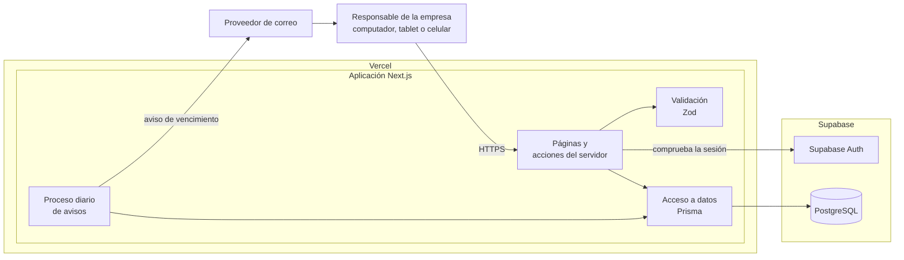

# capstone-2026-002D-equipo09

El sistema está en `Fase 2/Evidencias Proyecto/Evidencias de sistema`, en dos carpetas: **Aplicación** (código de la aplicación, Docker y variables de entorno), desde donde se ejecuta, y **Base de datos** (modelo y scripts de la base de datos).

## Nombre del proyecto

**MicroLogist**

## Descripción del proyecto

MicroLogist es una plataforma web orientada a pequeñas y medianas empresas de transporte de pasajeros. Permite centralizar y gestionar información de vehículos, conductores, turnos y documentación obligatoria, incorporando alertas para facilitar el control de vencimientos.

### ¿A quién va dirigido?

Está dirigido principalmente a responsables y propietarios de pequeñas y medianas empresas de transporte urbano, escolar, de trabajadores, estudiantes, viajes particulares y servicios turísticos.

### ¿Qué problema resuelve?

MicroLogist busca solucionar la dificultad de gestionar información operativa y documental que puede encontrarse dispersa en planillas, documentos físicos, calendarios o conversaciones de WhatsApp. Esto dificulta conocer el estado real de la flota y puede provocar olvidos en documentos importantes.

La plataforma centraliza esta información en un solo lugar, facilitando el seguimiento de vehículos, conductores, turnos y vencimientos, ayudando a mejorar la organización y gestión del servicio.

## Tecnologías utilizadas

| Tecnología | Uso |
|---|---|
| **Next.js** | Framework principal para desarrollar la aplicación web. |
| **React** | Se utilizará para crear la interfaz de usuario. |
| **TypeScript** | Se utilizará para desarrollar el código de la aplicación. |
| **Tailwind CSS** | Se utilizará para diseñar la interfaz y adaptarla a distintos dispositivos. |
| **PostgreSQL** | Base de datos donde se almacenará la información del sistema. |
| **Prisma ORM** | Se utilizará para conectar la aplicación con la base de datos y realizar consultas. |
| **Supabase** | Se utilizará para alojar la base de datos y gestionar servicios del sistema. |
| **Supabase Auth** | Se utilizará para gestionar el inicio de sesión y la autenticación de usuarios. |
| **Zod** | Se utilizará para validar los datos ingresados en el sistema. |
| **Vercel** | Se utilizará para desplegar y alojar la aplicación web. |
| **GitHub** | Se utilizará para almacenar el código y gestionar el trabajo del equipo. |

## Arquitectura

MicroLogist es una aplicación web en Next.js, desplegada en Vercel, que usa Supabase para la base de datos (PostgreSQL) y para el inicio de sesión (Supabase Auth). No necesita GPS ni equipos instalados en los vehículos.



| Capa | Qué hace | Dónde está en el código |
|---|---|---|
| **Interfaz** | Pantallas adaptables a computador y celular, hechas con React y Tailwind CSS. | `Aplicación/src/app/` |
| **Servidor** | Páginas y acciones del servidor de Next.js: comprueban la sesión, validan los datos y llaman al acceso a datos. La empresa del usuario siempre se toma de la sesión, nunca del formulario. | `Aplicación/src/app/` |
| **Validación** | Las reglas de cada módulo en esquemas Zod, compartidas por el formulario y el servidor. | `Aplicación/src/lib/` |
| **Acceso a datos** | Consultas a PostgreSQL con Prisma, siempre filtradas por la empresa del usuario. El modelo y las migraciones están en `Base de datos/`. | `Aplicación/src/lib/` |
| **Avisos** | Un proceso diario que busca documentos por vencer y envía un correo. El correo es el único canal de aviso. | Pendiente |

Los vehículos ya se guardan en PostgreSQL mediante Prisma (JOS-02 y JOS-03). El inicio de sesión usa Supabase Auth (SIM-02): el proxy (`src/proxy.ts`) manda al login a quien no tiene sesión, y cada página y acción vuelve a comprobarla en el servidor (`src/lib/sesion.ts`), que entrega la empresa del usuario. En desarrollo, sin las claves de Supabase, se entra sin iniciar sesión con la empresa de `EMPRESA_DESARROLLO_ID` del `.env` de `Aplicación/`.

El detalle está en el diagrama de componentes y en los diagramas de secuencia de [JOA-06](<Fase 2/Evidencias Proyecto/Evidencias de documentación/JOA-06_Diagramas_UML.md>).

## Instrucciones para ejecutar localmente

### Requisitos

- Node.js 24 o superior (versión usada por el equipo: 24)
- npm (se instala junto con Node.js)
- Git

### Instalación

1. Clonar el repositorio (se recomienda una carpeta corta y fuera de OneDrive, por ejemplo `C:\Proyectos`; en Windows, las rutas muy largas dan el error "Filename too long") y entrar a la carpeta de la aplicación. **Todos los comandos siguientes se ejecutan desde `Aplicación`.**

   ```bash
   git clone https://github.com/josemarcelovg/capstone-2026-002D-equipo09.git
   cd "capstone-2026-002D-equipo09/Fase 2/Evidencias Proyecto/Evidencias de sistema/Aplicación"
   ```

2. Instalar las dependencias (también genera el cliente de Prisma a partir de `Base de datos/schema.prisma`):

   ```bash
   npm install
   ```

3. Crear el archivo de variables de entorno a partir del ejemplo, en la misma carpeta `Aplicación`:

   ```bash
   cp .env.example .env
   ```

   Cómo obtener los valores está en [JOS-02](<Fase 2/Evidencias Proyecto/Evidencias de documentación/JOS-02_Configuracion_Base_de_Datos.md>). El archivo `.env` nunca se sube al repositorio.

4. Preparar la base de datos (Supabase + Prisma), con el `.env` completo:

   ```bash
   npm run db:deploy     # aplica las migraciones de Base de datos/migrations
   npm run db:seed       # carga las empresas y vehículos ficticios (Aplicación/prisma/seed.ts)
   npm run db:comprobar  # comprueba que todo funcione
   ```

5. Para usar el inicio de sesión, completar `NEXT_PUBLIC_SUPABASE_URL` y `NEXT_PUBLIC_SUPABASE_ANON_KEY`, y crear las cuentas de prueba y sus perfiles como indica [SIM-02](<Fase 2/Evidencias Proyecto/Evidencias de documentación/SIM-02_Inicio_de_Sesion.md>), sección 5. Sin esas dos variables, en desarrollo se entra directo con la empresa de `EMPRESA_DESARROLLO_ID`.

### Ejecución

| Comando | Para qué sirve |
|---|---|
| `npm run dev` | Inicia el servidor de desarrollo |
| `npm run build` | Compila la aplicación para producción |
| `npm run start` | Ejecuta la versión compilada |
| `npm run lint` | Revisa el código con ESLint |
| `npm test` | Ejecuta las pruebas automáticas unitarias |
| `npm run test:integracion` | Ejecuta las pruebas de integración con la base de datos y Supabase. Usa el `.env` y necesita `npm run dev` corriendo en otra terminal ([SIM-04](<Fase 2/Evidencias Proyecto/Evidencias de documentación/SIM-04_Plan_de_Pruebas.md>), sección 6.6) |

Con `npm run dev`, abrir http://localhost:3000 en el navegador.

> ⚠️ Usar la dirección `localhost` y no la que aparece como "Network": Next.js bloquea esa dirección en modo desarrollo y la página se ve vacía.

### Ejecutar con Docker (sin claves de Supabase)

Requiere [Docker Desktop](https://www.docker.com/products/docker-desktop/). Desde la carpeta `Aplicación`:

```bash
docker compose up --build
```

Levanta la aplicación y una base de datos PostgreSQL local con los datos de prueba. En Docker no se inicia sesión: se trabaja con la empresa de `EMPRESA_DESARROLLO_ID` (SIM-02). Abrir http://localhost:3000. Detalles y problemas frecuentes: [JOS-05](<Fase 2/Evidencias Proyecto/Evidencias de documentación/JOS-05_Entorno_Docker.md>).

### Estructura del repositorio

En la raíz están las carpetas de cada fase y este README.

| Carpeta | Contenido |
|---|---|
| `Fase 1/` | Evidencias individuales y grupales de la Fase 1 |
| `Fase 2/Evidencias Individuales/` y `Fase 2/Evidencias Grupales/` | Evidencias individuales y grupales de la Fase 2 |
| `Fase 2/Evidencias Proyecto/Evidencias de documentación/` | Documentos del proyecto (tabla de abajo) |
| `Fase 2/Evidencias Proyecto/Evidencias de sistema/` | El sistema: `Aplicación` y `Base de datos` |
| `Fase 3/` | Evidencias individuales y grupales de la Fase 3 |

Dentro de `Evidencias de sistema`:

| Carpeta | Contenido |
|---|---|
| `Aplicación/src/app/` | Páginas y rutas de la aplicación |
| `Aplicación/src/lib/` | Reglas de validación y acceso a datos |
| `Aplicación/public/` | Imágenes y archivos estáticos |
| `Aplicación/tests/` | Pruebas automáticas: unitarias en la carpeta y de integración en `tests/integracion/` |
| `Aplicación/prisma/` | Datos de prueba (`seed.ts`) y comprobación de la conexión (`comprobar.ts`) |
| `Aplicación/Capturas/` | Capturas de pantalla de la aplicación |
| `Aplicación/` (raíz) | `Dockerfile`, `compose.yaml`, `.env.example` y configuración del proyecto |
| `Base de datos/` | Modelo de datos (`schema.prisma`) y scripts SQL de las migraciones (`migrations/`) |

## Integrantes del equipo y roles

| Integrante | Rol |
|---|---|
| Simón Jofré | Scrum Master |
| Joaquín Orellana | Product Owner |
| José Vargas | Developer |

Los tres participan en análisis, diseño, desarrollo, pruebas y documentación.

## Metodología de trabajo

Para el desarrollo del proyecto se utilizará una metodología ágil e incremental, tomando como referencia algunos principios de Scrum. La idea es trabajar por etapas cortas, avanzando poco a poco y revisando constantemente lo que se va desarrollando. Primero se validará el problema y se definirán los requisitos principales. Después se evaluarán las tecnologías y la infraestructura que se utilizarán, se diseñará la solución y se comenzará con el desarrollo de un producto mínimo viable. Finalmente, se realizarán pruebas, correcciones, documentación y la presentación final del proyecto.

### Por qué elegimos Scrum

- **Los requisitos no están cerrados desde el inicio.** Varias reglas de los módulos (plazos de los avisos, campos de conductores y documentos, jornadas de los turnos) se irán definiendo y validando durante el proyecto. Un método por etapas permite ajustarlas sin rehacer todo, cosa que una metodología en cascada no facilita.
- **Hay que entregar valor por partes.** El producto se construye en etapas que ya se pueden usar y mostrar: primero inicio de sesión y vehículos, luego conductores, documentos, avisos y turnos, y al final el módulo opcional de ingresos.
- **El plazo es fijo y el equipo es pequeño.** Son 18 semanas con hitos ya definidos (idea validada en la semana 3, tecnologías en la 6, MVP integrado en la 14 y entrega final en la 18). Priorizar un backlog permite decidir qué entra si el tiempo no alcanza.
- **Los roles calzan con el equipo.** Un Product Owner que prioriza, un Scrum Master que organiza el trabajo y un Developer, con los tres participando en todas las etapas.

### Cómo la aplicamos

- **Artefactos:** [Product Vision](<Fase 2/Evidencias Proyecto/Evidencias de documentación/JOA-04_Product_Vision.md>), [Product Backlog](<Fase 2/Evidencias Proyecto/Evidencias de documentación/JOA-08_Product_Backlog.md>) priorizado por el Product Owner, [Definition of Done](<Fase 2/Evidencias Proyecto/Evidencias de documentación/SIM-05_Definition_of_Done.md>) acordada por el equipo, y [Sprint Backlog y retrospectivas](<Fase 2/Evidencias Proyecto/Evidencias de documentación/SIM-06_Sprint_Backlog_y_Retrospectivas.md>) de cada iteración (SIM-06).
- **Seguimiento:** un tablero en GitHub Projects con las tareas de cada integrante, sus responsables y criterios de aceptación, en estados pendiente, en curso y terminado. Se revisa en una reunión semanal.
- **Revisión del trabajo:** cada tarea se hace en su propia rama y se une a `main` mediante un pull request revisado por otro integrante.
- **Duración de los sprints:** el tablero usa iteraciones de 2 semanas (Iteración 3: 19-10 al 01-11). Que esa sea la duración de los sprints está **[POR CONFIRMAR]** con el equipo (SIM-06).

## Documentación del proyecto

| Documento | Contenido |
|---|---|
| [JOA-01 Reglas del módulo de vehículos](<Fase 2/Evidencias Proyecto/Evidencias de documentación/JOA-01_Reglas_Modulo_Vehiculos.md>) | Alcance, campos, permisos y criterios de aceptación de la primera entrega |
| [JOA-03 Validación de la primera entrega](<Fase 2/Evidencias Proyecto/Evidencias de documentación/JOA-03_Validacion_Primera_Entrega.md>) | Guion de la demostración, estado de cada criterio de aceptación y pendientes de la primera entrega |
| [JOA-04 Product Vision](<Fase 2/Evidencias Proyecto/Evidencias de documentación/JOA-04_Product_Vision.md>) | Visión, usuarios, objetivos y hoja de ruta |
| [JOA-05 Requisitos no funcionales](<Fase 2/Evidencias Proyecto/Evidencias de documentación/JOA-05_Requisitos_No_Funcionales.md>) | Seguridad, rendimiento, usabilidad, compatibilidad y disponibilidad |
| [JOA-06 Diagramas UML](<Fase 2/Evidencias Proyecto/Evidencias de documentación/JOA-06_Diagramas_UML.md>) | Casos de uso, secuencia, clases y componentes |
| [JOA-07 Innovación](<Fase 2/Evidencias Proyecto/Evidencias de documentación/JOA-07_Innovacion.md>) | Problema, alternativas existentes y aporte de MicroLogist |
| [JOA-08 Product Backlog](<Fase 2/Evidencias Proyecto/Evidencias de documentación/JOA-08_Product_Backlog.md>) | Historias de usuario priorizadas con sus criterios de aceptación |
| [JOA-09 Reglas del módulo de conductores](<Fase 2/Evidencias Proyecto/Evidencias de documentación/JOA-09_Reglas_Modulo_Conductores.md>) | Campos, formatos de RUT y teléfono, mensajes y criterios de aceptación de PB-08 a PB-10 |
| [JOS-02 Configuración de la base de datos](<Fase 2/Evidencias Proyecto/Evidencias de documentación/JOS-02_Configuracion_Base_de_Datos.md>) | Supabase, Prisma, migraciones y datos de prueba |
| [JOS-04 Modelo de datos](<Fase 2/Evidencias Proyecto/Evidencias de documentación/JOS-04_Modelo_de_Datos.md>) | Diagrama entidad-relación, diccionario de datos y separación entre empresas |
| [JOS-05 Entorno Docker](<Fase 2/Evidencias Proyecto/Evidencias de documentación/JOS-05_Entorno_Docker.md>) | Levantar la aplicación con una base de datos local, sin claves de Supabase |
| [JOS-06 Manual técnico](<Fase 2/Evidencias Proyecto/Evidencias de documentación/JOS-06_Manual_Tecnico.md>) | Arquitectura, código, configuración, base de datos, despliegue y operación |
| [SIM-02 Inicio de sesión](<Fase 2/Evidencias Proyecto/Evidencias de documentación/SIM-02_Inicio_de_Sesion.md>) | Inicio y cierre de sesión con Supabase Auth, decisiones y configuración |
| [SIM-03 Pruebas de la primera entrega](<Fase 2/Evidencias Proyecto/Evidencias de documentación/SIM-03_Pruebas_Primera_Entrega.md>) | Criterios 7.1 a 7.14 de JOA-01 probados con dos empresas ficticias, con verificación en la base de datos |
| [SIM-04 Plan de pruebas](<Fase 2/Evidencias Proyecto/Evidencias de documentación/SIM-04_Plan_de_Pruebas.md>) | Tipos de prueba (incluida la integración), casos con identificador, relación con JOA-05, calendario y estado de cada caso |
| [SIM-05 Definition of Done](<Fase 2/Evidencias Proyecto/Evidencias de documentación/SIM-05_Definition_of_Done.md>) | Condiciones para dar una tarea por terminada |
| [SIM-06 Sprint Backlog y retrospectivas](<Fase 2/Evidencias Proyecto/Evidencias de documentación/SIM-06_Sprint_Backlog_y_Retrospectivas.md>) | Tareas de cada iteración, datos para las retrospectivas y acciones de mejora |
