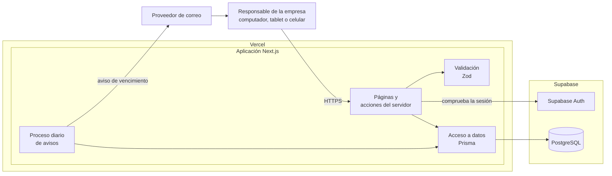

# capstone-2026-002D-equipo09

## Nombre del proyecto

**MicroLogist**

## Descripción del proyecto

MicroLogist es una plataforma web orientada a pequeñas y medianas empresas de transporte de pasajeros. Permite centralizar y gestionar información de vehículos, conductores, turnos y documentación obligatoria, incorporando alertas para facilitar el control de vencimientos.

### ¿A quién va dirigido?

Está dirigido principalmente a responsables y propietarios de pequeñas y medianas empresas de transporte urbano, escolar, de trabajadores, estudiantes, viajes particulares y servicios turísticos.

### ¿Qué problema resuelve?

MicroLogist busca solucionar la dificultad de gestionar información operativa y documental que puede encontrarse dispersa en planillas, documentos físicos, calendarios o conversaciones de WhatsApp. Esto dificulta conocer el estado real de la flota y puede provocar olvidos en documentos importantes.

La plataforma centraliza esta información en un solo lugar, facilitando el seguimiento de vehículos, conductores, turnos y vencimientos, ayudando a mejorar la organización y gestión del servicio.

## Tecnologías utilizadas

| Tecnología | Uso |
|---|---|
| **Next.js** | Framework principal para desarrollar la aplicación web. |
| **React** | Se utilizará para crear la interfaz de usuario. |
| **TypeScript** | Se utilizará para desarrollar el código de la aplicación. |
| **Tailwind CSS** | Se utilizará para diseñar la interfaz y adaptarla a distintos dispositivos. |
| **PostgreSQL** | Base de datos donde se almacenará la información del sistema. |
| **Prisma ORM** | Se utilizará para conectar la aplicación con la base de datos y realizar consultas. |
| **Supabase** | Se utilizará para alojar la base de datos y gestionar servicios del sistema. |
| **Supabase Auth** | Se utilizará para gestionar el inicio de sesión y la autenticación de usuarios. |
| **Zod** | Se utilizará para validar los datos ingresados en el sistema. |
| **Vercel** | Se utilizará para desplegar y alojar la aplicación web. |
| **GitHub** | Se utilizará para almacenar el código y gestionar el trabajo del equipo. |

## Arquitectura

MicroLogist es una aplicación web en Next.js, desplegada en Vercel, que usa Supabase para la base de datos (PostgreSQL) y para el inicio de sesión (Supabase Auth). No necesita GPS ni equipos instalados en los vehículos.



| Capa | Qué hace | Dónde está en el código |
|---|---|---|
| **Interfaz** | Pantallas adaptables a computador y celular, hechas con React y Tailwind CSS. | `src/app/` |
| **Servidor** | Páginas y acciones del servidor de Next.js: comprueban la sesión, validan los datos y llaman al acceso a datos. La empresa del usuario siempre se toma de la sesión, nunca del formulario. | `src/app/` |
| **Validación** | Las reglas de cada módulo en esquemas Zod, compartidas por el formulario y el servidor. | `src/lib/` |
| **Acceso a datos** | Consultas a PostgreSQL con Prisma, siempre filtradas por la empresa del usuario. | `src/lib/` |
| **Avisos** | Un proceso diario que busca documentos por vencer y envía un correo. El correo es el único canal de aviso. | Pendiente |

Por ahora el acceso a datos usa datos de ejemplo en memoria; la conexión con Prisma y Supabase está en desarrollo (JOS-02 y JOS-03), y el inicio de sesión se implementa en SIM-02.

El detalle está en el diagrama de componentes y en los diagramas de secuencia de [JOA-06](docs/fase2-desarrollo/JOA-06_Diagramas_UML.md).

## Instrucciones para ejecutar localmente

### Requisitos

- Node.js 24 o superior (versión usada por el equipo: 24)
- npm (se instala junto con Node.js)
- Git

### Instalación

1. Clonar el repositorio (se recomienda una carpeta fuera de OneDrive, por ejemplo `C:\Proyectos`):

   ```bash
   git clone https://github.com/josemarcelovg/capstone-2026-002D-equipo09.git
   cd capstone-2026-002D-equipo09
   ```

2. Instalar las dependencias:

   ```bash
   npm install
   ```

3. Crear el archivo de variables de entorno a partir del ejemplo:

   ```bash
   cp .env.example .env
   ```

   Los valores se completarán cuando se configure Supabase. El archivo `.env` nunca se sube al repositorio.

### Ejecución

| Comando | Para qué sirve |
|---|---|
| `npm run dev` | Inicia el servidor de desarrollo |
| `npm run build` | Compila la aplicación para producción |
| `npm run start` | Ejecuta la versión compilada |
| `npm run lint` | Revisa el código con ESLint |
| `npm test` | Ejecuta las pruebas automáticas |

Con `npm run dev`, abrir http://localhost:3000 en el navegador.

> ⚠️ Usar la dirección `localhost` y no la que aparece como "Network": Next.js bloquea esa dirección en modo desarrollo y la página se ve vacía.

### Estructura del repositorio

| Carpeta | Contenido |
|---|---|
| `src/app/` | Páginas y rutas de la aplicación |
| `src/lib/` | Reglas de validación y acceso a datos |
| `public/` | Imágenes y archivos estáticos |
| `docs/` | Documentación del proyecto por fase |
| `database/` | Scripts y recursos de base de datos |
| `docker/` | Configuración de Docker |
| `tests/` | Pruebas automáticas |

## Integrantes del equipo y roles

| Integrante | Rol |
|---|---|
| Simón Jofré | Scrum Master |
| Joaquín Orellana | Product Owner |
| José Vargas | Developer |

Los tres participan en análisis, diseño, desarrollo, pruebas y documentación.

## Metodología de trabajo

Para el desarrollo del proyecto se utilizará una metodología ágil e incremental, tomando como referencia algunos principios de Scrum. La idea es trabajar por etapas cortas, avanzando poco a poco y revisando constantemente lo que se va desarrollando. Primero se validará el problema y se definirán los requisitos principales. Después se evaluarán las tecnologías y la infraestructura que se utilizarán, se diseñará la solución y se comenzará con el desarrollo de un producto mínimo viable. Finalmente, se realizarán pruebas, correcciones, documentación y la presentación final del proyecto.

### Por qué elegimos Scrum

- **Los requisitos no están cerrados desde el inicio.** Varias reglas de los módulos (plazos de los avisos, campos de conductores y documentos, jornadas de los turnos) se irán definiendo y validando durante el proyecto. Un método por etapas permite ajustarlas sin rehacer todo, cosa que una metodología en cascada no facilita.
- **Hay que entregar valor por partes.** El producto se construye en etapas que ya se pueden usar y mostrar: primero inicio de sesión y vehículos, luego conductores, documentos, avisos y turnos, y al final el módulo opcional de ingresos.
- **El plazo es fijo y el equipo es pequeño.** Son 18 semanas con hitos ya definidos (idea validada en la semana 3, tecnologías en la 6, MVP integrado en la 14 y entrega final en la 18). Priorizar un backlog permite decidir qué entra si el tiempo no alcanza.
- **Los roles calzan con el equipo.** Un Product Owner que prioriza, un Scrum Master que organiza el trabajo y un Developer, con los tres participando en todas las etapas.

### Cómo la aplicamos

- **Artefactos:** [Product Vision](docs/fase2-desarrollo/JOA-04_Product_Vision.md), [Product Backlog](docs/fase2-desarrollo/JOA-08_Product_Backlog.md) priorizado por el Product Owner, [Definition of Done](docs/fase2-desarrollo/SIM-05_Definition_of_Done.md) acordada por el equipo, y Sprint Backlog y retrospectivas de cada sprint (SIM-06, en preparación).
- **Seguimiento:** un tablero en GitHub Projects con las tareas de cada integrante, sus responsables y criterios de aceptación, en estados pendiente, en curso y terminado. Se revisa en una reunión semanal.
- **Revisión del trabajo:** cada tarea se hace en su propia rama y se une a `main` mediante un pull request revisado por otro integrante.
- **Duración de los sprints:** **[POR CONFIRMAR]** con el equipo.

## Documentación del proyecto

| Documento | Contenido |
|---|---|
| [JOA-01 Reglas del módulo de vehículos](docs/fase2-desarrollo/JOA-01_Reglas_Modulo_Vehiculos.md) | Alcance, campos, permisos y criterios de aceptación de la primera entrega |
| [JOA-04 Product Vision](docs/fase2-desarrollo/JOA-04_Product_Vision.md) | Visión, usuarios, objetivos y hoja de ruta |
| [JOA-05 Requisitos no funcionales](docs/fase2-desarrollo/JOA-05_Requisitos_No_Funcionales.md) | Seguridad, rendimiento, usabilidad, compatibilidad y disponibilidad |
| [JOA-06 Diagramas UML](docs/fase2-desarrollo/JOA-06_Diagramas_UML.md) | Casos de uso, secuencia, clases y componentes |
| [JOA-07 Innovación](docs/fase2-desarrollo/JOA-07_Innovacion.md) | Problema, alternativas existentes y aporte de MicroLogist |
| [JOA-08 Product Backlog](docs/fase2-desarrollo/JOA-08_Product_Backlog.md) | Historias de usuario priorizadas con sus criterios de aceptación |
| [SIM-05 Definition of Done](docs/fase2-desarrollo/SIM-05_Definition_of_Done.md) | Condiciones para dar una tarea por terminada |
